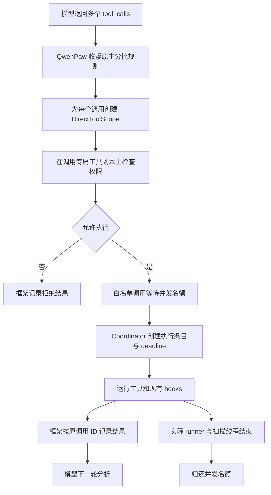

# Windows 非 Coding 模式：工具调用并行改造方案与代码

> 文档性质：实施前评审稿。以下业务代码均为拟议修改，本次只新增此 Markdown 文档。
>
> 适用范围：Windows、`is_coding_mode=False`、当前直接运行配置、无沙箱。
>
> 目标：模型一次提出多个独立工具调用，运行时受控并行执行，沿用调用 ID 回收结果，再由模型继续分析。
>
> 核对日期：2026-10-13。本文以当前工作区及已安装依赖为准；行号只用于定位，以类名和函数名为修改锚点。

阅读路径：第 1–3 节说明现状和设计；第 4–13 节按文件给出修改代码；第 14–17 节说明结果关联、测试、实施与边界。DashScope 的独立修复放在附录 A。

## 1. 结论与环境基线

当前项目不需要重新实现一套 `gather` 调度，也不需要恢复旧的 `run_tool_batch`。AgentScope 2.0.4 已提供原生工具分批、并发执行、事件输出和按工具调用 ID 写入结果的机制。需要补齐的是：明确哪些工具允许并行、隔离每次调用的权限缓存、明确无沙箱执行路径，以及限制真正仍在运行的任务数量。

本次方案按当前条件调整：

- 使用 QwenPaw 当前继承的 AgentScope 2.0 `Agent` 执行链。
- 只在 Windows 非 Coding 直接运行场景启用以下改造。
- 首批只开放 `read_file`、`grep_search`、`glob_search`、`web_search`、`web_fetch`。
- Shell、文件写入、浏览器控制、桌面控制、插件工具、状态注入工具和其他未审核工具按顺序执行。
- 无沙箱是执行方式；原有策略判断、审批、审计、路径边界和工具自身检查继续生效。
- 正常结束的批次等待该批结果后再进入模型下一轮；当前已有的后台执行语义保留，其占位结果不等于实际完成。

| 项目 | 当前核对值 |
| --- | --- |
| 工作区 | `D:\project\fw_agent\code\paw\copaw\copaw` |
| 分支 / HEAD | `branch_performance_acceleration` / `787615d` |
| Python | `.venv` 中的 3.11.9 |
| QwenPaw | 2.0.0 |
| AgentScope | 2.0.4 |
| OpenAI Python SDK | 2.33.0 |
| AnyIO | 4.12.1 |
| Windows 锁文件 | `requirements-windows.lock.txt`；之前核对的 263 个已安装分发版本与锁文件一致 |
| 依赖检查 | 之前执行的 `pip check` 通过 |
| 当前模型路径 | 当前运行配置 / 日志为 `lcfc / gpt-oss-120b`，使用 `OpenAIChatModel`；运行时方案不依赖这个具体模型 |

这些版本是本地环境观测值，不能据此推断其他安装环境也已具备相同接口。后续升级 AgentScope 时，需要重验本文覆盖的两个内部方法签名。

当前启动代码在 `src/qwenpaw/cli/main.py` 的 `apply_devco_bundle_env` 调用中传入：

```python
qwenpaw_force_direct_subprocess_sync="1"
```

它对应 `QWENPAW_FORCE_DIRECT_SUBPROCESS_SYNC`。`shell.py` 的直接运行分支把同步子进程执行交给 `asyncio.to_thread`，并在进入后续沙箱分支之前返回。这个标志本身只是 Shell 执行路由，**不能当作所有治理代码都已停止编译和注入沙箱配置的证明**。下面显式处理这条差异。

## 2. 当前代码为什么仍需要改

### 2.1 已经存在的执行和结果关联机制

当前安装的 `.venv/Lib/site-packages/agentscope/agent/_agent.py`：

| 函数 | 当前作用 |
| --- | --- |
| `_batch_tool_calls`，约 1336 行 | 按 `tool.is_concurrency_safe` 分为 concurrent / sequential 批次 |
| `_execute_concurrent_tool_calls`，约 1425 行 | 执行并发批次，使用 `asyncio.gather(..., return_exceptions=True)` |
| `_execute_tool_call`，约 1563 行 | 参数校验、权限检查、执行、事件输出、写回结果 |
| `_acting` / `_acting_impl` | 经过 middleware 后调用 Toolkit |
| `_get_executable_tool_calls`，约 2638 行 | 选择尚无对应结果的工具调用 |

最终结果写成带有原 `tool_call.id` 的 `ToolResultBlock`。项目中的 `ToolCoordinator` 也以调用 ID 保存 `ToolCallEntry`。这些机制应继续使用，避免新增一个与框架重复的结果缓存。

### 2.2 权限状态当前保存在共享工具实例上

`src/qwenpaw/governance/tool_adapter.py` 中的 `PolicyGuardedTool` 目前把下列状态写入工具实例：

```text
_qp_raw_params
_qp_tc_spec
_qp_policy_decision
_qp_sandbox_mode
_qp_sandbox_config
_qp_request_context
```

同一个工具实例服务于多次调用。A 的权限检查之后，如果 B 覆盖这些字段，A 的执行后处理可能读到 B 的审批目标。**即便无沙箱，也存在权限状态串用的风险。**

当前 `_policy_tool_call` 还会把任意 `ToolChunk(state=DENIED)` 当作沙箱违规进入升级审批流程。路径检查等工具本身也会返回 DENIED，因此直接运行模式必须保留原拒绝结果，不能以“沙箱违规”为由再尝试绕过。

### 2.3 async 取消不等于搜索线程退出

`grep_search`、`glob_search` 当前把目录扫描提交到 `asyncio.to_thread`。取消等待它的 asyncio Task，并不保证运行中的 Python 线程立即停止。

若“请求返回了”就释放并发名额，实际扫描线程仍可能继续占用磁盘，随后新任务又启动，最终突破限额。下面用真实的 `concurrent.futures.Future` 追踪扫描线程，等运行协程及扫描线程都结束再归还名额。

### 2.4 超时和后台执行不能混为一谈

`ToolCoordinator.execute` 可能在达到 deadline 或被请求转入后台后返回占位结果，而 `entry.background_task` 仍在运行。因此：

- 排队时间不计入 Coordinator 的执行 deadline。
- 并发名额交给实际后台任务持有。
- 后台占位结果必须被描述为“尚未完成”。
- 第一版不增加“全部后台任务完成前禁止模型继续”的硬等待屏障。

最后一条是现有交互的保留边界。若业务要求最终答复必须等待所有后台工作完成，需要另行改造回合结束条件；仅靠本方案的提示词不能强制保证。

## 3. 调用链、白名单与限额



| 层级 | 第一版限制 | 覆盖范围 |
| --- | --- | --- |
| 单个 concurrent 批次 | 4 个调用 | 当前 agent 回合 |
| 单会话 | 4 个执行名额 | 同一 event loop 内同 session_id 的白名单任务，包括仍在后台的任务 |
| 全局 | 8 个执行名额 | 同一 event loop 的白名单任务 |
| file_read | 4 | `read_file` |
| file_search | 2 | `grep_search` / `glob_search`，共享扫描线程池 |
| network | 3 | `web_search` / `web_fetch` |
| 排队等待 | 最多 60 秒 | 在创建 Coordinator deadline 之前 |

这些是初始工程参数，不是性能实测最优值。多进程、多 event loop 部署时，每个 event loop 独立计数；不能宣传为跨进程全局限额。未知或空 session_id 统一进入匿名会话限额，避免绕开限制。

这个限制只覆盖并行白名单。它不是全应用所有 Shell、浏览器、后台任务的统一资源配额。也不保证严格 FIFO 公平调度；后续如出现会话饥饿，可将多信号量方案换成统一排队调度器。

安全属性只能证明运行时可同时调用，不能证明业务依赖关系。模型必须先完成路径发现等前置步骤，再同时读取已确定的独立文件。需要前一调用结果才能填写后一调用参数的任务仍应分轮执行。

### 3.1 涉及文件

以下路径均相对于仓库根目录 `D:\project\fw_agent\code\paw\copaw\copaw`。

| 文件 | 操作 | 内容 |
| --- | --- | --- |
| `src/qwenpaw/config/tool_parallel.py` | 新增 | 场景判断、调用作用域、执行名额 |
| `src/qwenpaw/runtime/tool_registry.py` | 修改 | 增加明确的安全 / 只读 / 分组字段 |
| `src/qwenpaw/app/workspace/local_workspace.py` | 修改 | 把字段传给 FunctionTool，写入私有白名单标记 |
| `src/qwenpaw/agents/react_agent.py` | 修改 | 调用前创建作用域；收紧并发批次 |
| `src/qwenpaw/governance/tool_adapter.py` | 修改 | 每次调用使用独立副本；直接路径保留 DENIED |
| `src/qwenpaw/governance/resource_governor.py` | 修改 | 策略评估增加 `allow_sandbox` 参数 |
| `src/qwenpaw/tool_calls/_middleware.py` | 修改 | 权限检查之后获取执行名额 |
| `src/qwenpaw/tool_calls/_coordinator.py` | 修改 | 绑定名额所有权；保护重复 ID；限制权限检查后的参数变更 |
| `src/qwenpaw/agents/tools/file_io.py` | 修改 | 标记 read_file |
| `src/qwenpaw/agents/tools/file_search.py` | 修改 | 标记搜索工具，追踪实际扫描 Future |
| `src/qwenpaw/agents/tools/web_search.py` | 修改 | 标记两个网络工具 |
| `src/qwenpaw/runtime/builder.py` | 修改 | 提示词元数据；隐藏需沙箱的历史 Python REPL |
| `src/qwenpaw/runtime/prompt_contributors.py` | 修改 | 提供准确的并行调用提示 |
| `tests/test_windows_tool_parallel.py` | 拟新增 | 核心机制回归测试 |
| `src/qwenpaw/providers/dashscope_provider.py` | 可选修改 | 附录中的参数透传修复；当前 OpenAI 路径不以它为前提 |

不修改 `.venv` 中的框架源码，不调整当前依赖版本，也不新增批处理工具供模型转调。

## 4. 新增调用作用域与执行名额模块

位置：`src/qwenpaw/config/tool_parallel.py`。下面是新文件的完整代码。

```python
from __future__ import annotations

import asyncio
import copy
import os
import sys
from contextvars import ContextVar
from dataclasses import dataclass, field
from typing import Any
from weakref import WeakValueDictionary

GROUP_LIMITS = {"file_read": 4, "file_search": 2, "network": 3}
PARALLEL_TOOL_GROUPS = {
    "read_file": "file_read",
    "grep_search": "file_search",
    "glob_search": "file_search",
    "web_search": "network",
    "web_fetch": "network",
}


def is_windows_non_coding_direct(ctx: dict[str, Any] | None) -> bool:
    return (
        sys.platform == "win32"
        and bool(ctx)
        and ctx.get("is_coding_mode") is False
        and os.getenv("QWENPAW_FORCE_DIRECT_SUBPROCESS_SYNC", "").strip().lower()
        in {"1", "true", "yes", "on"}
    )


def parallel_enabled(ctx: dict[str, Any] | None) -> bool:
    return is_windows_non_coding_direct(ctx) and os.getenv(
        "QWENPAW_NON_CODING_TOOL_PARALLEL", "1"
    ).strip().lower() in {"1", "true", "yes", "on"}


@dataclass
class DirectToolScope:
    request_context: dict[str, Any]
    tool_copies: dict[int, Any] = field(default_factory=dict)
    execution_lease: Any = None

    def policy_tool(self, original: Any) -> Any:
        key = id(original)
        if key not in self.tool_copies:
            tool = copy.copy(original)
            tool._qp_request_context = {
                **(getattr(original, "_qp_request_context", None) or {}),
                **self.request_context,
            }
            tool._qp_raw_params = {}
            tool._qp_tc_spec = None
            tool._qp_policy_decision = None
            tool._qp_sandbox_mode = False
            tool._qp_sandbox_config = None
            tool._qp_direct_execution = True
            self.tool_copies[key] = tool
        return self.tool_copies[key]


_direct_scope: ContextVar[DirectToolScope | None] = ContextVar(
    "qwenpaw_direct_tool_scope", default=None
)


def get_direct_scope() -> DirectToolScope | None:
    return _direct_scope.get()


def set_direct_scope(scope: DirectToolScope):
    return _direct_scope.set(scope)


def reset_direct_scope(token) -> None:
    _direct_scope.reset(token)


class ExecutionLease:
    def __init__(self, permits: list[asyncio.Semaphore], wait_ms: float):
        self._permits = permits
        self.queue_wait_ms = wait_ms
        self._loop = asyncio.get_running_loop()
        self._bound = False
        self._runner_done = False
        self._released = False
        self._workers: list[Any] = []

    def bind_runner(self, task: asyncio.Task) -> None:
        if self._bound:
            raise RuntimeError("Execution lease already has an owner")
        self._bound = True
        task.add_done_callback(self._on_runner_done)

    def _on_runner_done(self, task: asyncio.Task) -> None:
        self._runner_done = True
        self._try_release()

    def track_worker(self, future: Any) -> None:
        self._workers.append(future)
        future.add_done_callback(self._on_worker_done)

    def _on_worker_done(self, future: Any) -> None:
        if not self._loop.is_closed():
            self._loop.call_soon_threadsafe(self._try_release)

    def close_if_unbound(self) -> None:
        if not self._bound:
            self._runner_done = True
            self._try_release()

    def _try_release(self) -> None:
        if self._released or not self._runner_done:
            return
        if any(not future.done() for future in self._workers):
            return
        self._released = True
        for permit in reversed(self._permits):
            permit.release()


class ToolPermitPool:
    def __init__(self):
        self._global = asyncio.Semaphore(8)
        self._groups = {
            name: asyncio.Semaphore(limit)
            for name, limit in GROUP_LIMITS.items()
        }
        self._sessions = WeakValueDictionary()

    async def acquire(self, session_id: str, group: str) -> ExecutionLease:
        session_key = session_id or "__anonymous__"
        session = self._sessions.get(session_key)
        if session is None:
            session = asyncio.Semaphore(4)
            self._sessions[session_key] = session

        acquired: list[asyncio.Semaphore] = []
        loop = asyncio.get_running_loop()
        started = loop.time()
        try:
            async with asyncio.timeout(60):
                for permit in (self._groups[group], session, self._global):
                    await permit.acquire()
                    acquired.append(permit)
            return ExecutionLease(acquired, (loop.time() - started) * 1000)
        except BaseException:
            for permit in reversed(acquired):
                permit.release()
            raise


def get_permit_pool() -> ToolPermitPool:
    loop = asyncio.get_running_loop()
    pool = getattr(loop, "_qwenpaw_tool_permit_pool", None)
    if pool is None:
        pool = ToolPermitPool()
        setattr(loop, "_qwenpaw_tool_permit_pool", pool)
    return pool
```

实现说明：

1. 场景判断要求 `is_coding_mode` 明确为布尔 `False`。上下文缺失时不擅自进入无沙箱模式。
2. `DirectToolScope` 在进入框架的整个单工具生命周期之前设置，因此权限检查和真正执行拿到同一专属副本。
3. 副本只隔离本方案明确识别的调用缓存；底层函数、schema 和 governor 保留引用，避免复制锁、服务对象或注册信息。不要把这个浅复制方案泛化到任意插件对象。
4. `ContextVar` 会随 asyncio 新任务传播；线程池搜索另用 `copy_context` 显式传播。
5. `ExecutionLease` 绑定到实际 runner，不绑到流式响应消费者。用户收到后台占位结果后，名额仍被持有。
6. `track_worker` 登记真实扫描 Future。runner 被取消时，只要扫描线程未退出，就不释放名额。
7. `WeakValueDictionary` 避免无限积累会话信号量。等待任务和持有名额的 lease 会维持必要的强引用。
8. 名额池挂在当前 event loop 上，避免把 asyncio 信号量跨 event loop 复用。进程退出时仍需沿用应用自己的任务关闭流程。
9. 排队中取消或超时会释放已经拿到的部分名额；绑定后的名额只由 runner / worker 完成回调归还。
10. 白名单同时要求工具名称命中固定表，且 descriptor 属性与分组匹配；插件仅声明安全属性不会自动获得并行资格。
11. 新开关 `QWENPAW_NON_CODING_TOOL_PARALLEL` 默认开启。设为 `0` 可关闭白名单并行；直接执行和调用状态隔离修复仍然生效。

## 5. 为工具声明显式并发属性

位置：`src/qwenpaw/runtime/tool_registry.py`。

### 5.1 替换 ToolDescriptor 的字段区

保留类的现有说明和 `@dataclass(frozen=True)`，字段区替换为：

```python
    name: str
    func: Callable[..., Any]
    enabled_by_default: bool = True
    requires_modes: tuple[str, ...] = ()
    requires_skills: tuple[str, ...] = ()
    requires_features: tuple[str, ...] = ()
    requires_sandbox: tuple[str, ...] = ()
    async_execution: bool = False
    non_coding_only: bool = False
    description: str = ""
    metadata: dict[str, Any] = field(default_factory=dict)
    is_concurrency_safe: bool = False
    is_read_only: bool = False
    concurrency_group: str = ""
```

新字段放在现有字段之后，尽量保持旧的位置参数顺序。安全属性默认 False，避免“默认全都安全”。`requires_sandbox` 是现有资源需求描述，不能直接用它判断工具是否可以并行。

### 5.2 完整替换 tool_descriptor 函数

```python
def tool_descriptor(
    *,
    name: str | None = None,
    enabled_by_default: bool = True,
    requires_modes: tuple[str, ...] = (),
    requires_skills: tuple[str, ...] = (),
    requires_features: tuple[str, ...] = (),
    requires_sandbox: tuple[str, ...] = (),
    async_execution: bool | None = None,
    non_coding_only: bool = False,
    description: str = "",
    is_concurrency_safe: bool = False,
    is_read_only: bool = False,
    concurrency_group: str = "",
    **metadata: Any,
) -> Callable[[Callable[..., Any]], Callable[..., Any]]:
    """Attach an explicit descriptor and auto-collect the tool function."""

    def deco(fn: Callable[..., Any]) -> Callable[..., Any]:
        import inspect

        resolved_name = name or fn.__name__
        is_async = (
            async_execution
            if async_execution is not None
            else inspect.iscoroutinefunction(fn)
        )
        fn._tool_descriptor = ToolDescriptor(
            name=resolved_name,
            func=fn,
            enabled_by_default=enabled_by_default,
            requires_modes=tuple(requires_modes),
            requires_skills=tuple(requires_skills),
            requires_features=tuple(requires_features),
            requires_sandbox=tuple(requires_sandbox),
            async_execution=is_async,
            non_coding_only=non_coding_only,
            description=(
                description or (fn.__doc__ or "").strip().splitlines()[0]
                if fn.__doc__
                else description
            ),
            metadata=dict(metadata),
            is_concurrency_safe=is_concurrency_safe,
            is_read_only=is_read_only,
            concurrency_group=concurrency_group,
        )
        if id(fn) not in _REGISTERED_IDS:
            _REGISTERED_IDS.add(id(fn))
            _REGISTERED_TOOL_FUNCS.append(fn)
        return fn

    return deco
```

不要把这些属性只放进 `metadata` 后忘记消费。这里为它们新增显式字段，下一节直接使用这些字段。

## 6. 在工作区注册工具时传入安全属性

位置：`src/qwenpaw/app/workspace/local_workspace.py`，约 51 行的 `QwenPawLocalWorkspace.list_tools`。

完整替换该方法：

```python
    async def list_tools(
        self,
        *,
        agent_config: Any = None,
        agent_id: str | None = None,
        request_context: dict[str, Any] | None = None,
        active_modes: tuple[str, ...] | set[str] = (),
        active_skills: tuple[str, ...] | set[str] = (),
        enabled_features: tuple[str, ...] | set[str] = (),
    ) -> list[Any]:
        from ...config.tool_parallel import (
            GROUP_LIMITS,
            PARALLEL_TOOL_GROUPS,
            is_windows_non_coding_direct,
            parallel_enabled,
        )
        from ...governance import PolicyGuardedTool

        if agent_config is not None:
            allowed, denied = self._resolve_config_gates(agent_config)
        else:
            allowed, denied = None, set()

        descs = self._tool_registry.filter(
            active_modes=set(active_modes),
            active_skills=set(active_skills),
            enabled_features=set(enabled_features),
            allowed=allowed,
            denied=denied,
        )
        if request_context and request_context.get("is_coding_mode"):
            descs = [d for d in descs if not d.non_coding_only]

        direct = is_windows_non_coding_direct(request_context)
        enabled = parallel_enabled(request_context)
        tools: list[Any] = []
        for desc in descs:
            eligible = (
                enabled
                and desc.is_concurrency_safe
                and desc.is_read_only
                and desc.concurrency_group in GROUP_LIMITS
                and desc.name in PARALLEL_TOOL_GROUPS
                and desc.concurrency_group == PARALLEL_TOOL_GROUPS[desc.name]
            )
            tool_kwargs: dict[str, Any] = {}
            if direct:
                tool_kwargs.update(
                    is_concurrency_safe=eligible,
                    is_read_only=desc.is_read_only,
                )
            tool = PolicyGuardedTool(
                desc.func,
                governor=self._governor,
                request_context=request_context,
                **tool_kwargs,
            )
            tool._qp_non_coding_parallel = eligible
            tool._qp_concurrency_group = desc.concurrency_group
            tools.append(tool)
        return tools
```

当前 FunctionTool 默认 `is_concurrency_safe=True`，所以只新增 descriptor 而不传给包装器不会达到目标。这里在目标场景显式覆盖默认值；其他场景保留目前包装器参数行为。

框架后面仍可能注册其他工具。因此还需要下一节的 Agent 级二次筛选，防止未经过该白名单的工具沿用框架默认 True。

## 7. 在 Agent 中隔离调用，并收紧原生分批

位置：`src/qwenpaw/agents/react_agent.py`，在 `QwenPawAgent` 类内新增下面两个方法。当前类没有覆盖这两个方法，可放在 `_register_tool_call_hooks` 前。

### 7.1 在权限检查之前建立调用作用域

```python
    async def _execute_tool_call(self, tool_call):
        from ..config.context import current_request_context
        from ..config.tool_parallel import (
            DirectToolScope,
            is_windows_non_coding_direct,
            reset_direct_scope,
            set_direct_scope,
        )

        request_context = dict(self._request_context or {})
        if not is_windows_non_coding_direct(request_context):
            async for event in super()._execute_tool_call(tool_call):
                yield event
            return

        request_context["tool_call_id"] = tool_call.id
        request_context["reply_id"] = self.state.reply_id
        scope = DirectToolScope(request_context=request_context)
        scope_token = set_direct_scope(scope)
        context_token = current_request_context.set(request_context)
        try:
            async for event in super()._execute_tool_call(tool_call):
                yield event
        finally:
            current_request_context.reset(context_token)
            reset_direct_scope(scope_token)
```

`current_request_context` 使用原项目 ContextVar 的 token reset，避免覆盖同时运行的其他调用上下文。审批、路径解析、审计辅助逻辑读到该调用自己的 `tool_call_id`、`session_id` 和目录配置。

无需复制 AgentState，也不能让每个并发工具改写一个公共 `agent._request_context`。框架已负责单回合中的结果管理。

### 7.2 收紧框架已生成的批次

```python
    async def _batch_tool_calls(self):
        from ..config.tool_parallel import (
            PARALLEL_TOOL_GROUPS,
            is_windows_non_coding_direct,
        )
        from ..tool_calls._middleware import ToolCoordinatorMiddleware

        batches = await super()._batch_tool_calls()
        if not is_windows_non_coding_direct(self._request_context):
            return batches

        has_coordinator = any(
            isinstance(middleware, ToolCoordinatorMiddleware)
            for middleware in self._acting_middlewares
        )
        result = []
        for original in batches:
            current = None
            for tool_call in original.tool_calls:
                tool = await self.toolkit.get_tool(tool_call.name)
                eligible = (
                    has_coordinator
                    and original.type == "concurrent"
                    and tool is not None
                    and tool_call.name in PARALLEL_TOOL_GROUPS
                    and getattr(tool, "_qp_non_coding_parallel", False)
                    and tool.is_concurrency_safe
                    and tool.is_read_only
                    and not getattr(tool, "is_state_injected", False)
                )
                batch_type = "concurrent" if eligible else "sequential"
                if (
                    current is None
                    or current.type != batch_type
                    or (
                        batch_type == "concurrent"
                        and len(current.tool_calls) >= 4
                    )
                ):
                    current = type(original)(
                        type=batch_type,
                        tool_calls=[],
                    )
                    result.append(current)
                current.tool_calls.append(tool_call)
        return result
```

这个方法只把原有批次收紧，不跨越原框架已经设置的顺序边界。使用 `type(original)` 构造同类批次，避免直接导入框架私有 `_ToolCallBatch`；但覆盖方法本身仍属于版本敏感接入点。

示例：

```text
输入：
read_file(A), read_file(B), write_file(C), read_file(D), read_file(E)

执行批次：
concurrent [read_file(A), read_file(B)]
sequential [write_file(C)]
concurrent [read_file(D), read_file(E)]
```

顺序批次保证先后调用的启动顺序。若写入工具转入后台，它仍可能没有实际结束；后续依赖该写入的读取必须等待真实完成结果，不能把“后台运行中”视为已写完。

## 8. 隔离 PolicyGuardedTool 的每次调用状态

位置：`src/qwenpaw/governance/tool_adapter.py`。

### 8.1 重命名现有实现，保持动态类绑定名称不变

将现有两个函数的定义改名：

```diff
-async def _policy_tool_check_permissions(
+async def _policy_tool_check_permissions_impl(

-async def _policy_tool_call(
+async def _policy_tool_call_impl(
```

`PolicyGuardedTool.__new__` 的动态类方法映射保留原名称：

```python
"check_permissions": _policy_tool_check_permissions,
"__call__": _policy_tool_call,
```

映射将调用下面的新入口，其他模式仍委托给原实现。这里不对动态生成的包装器做 `isinstance(tool, PolicyGuardedTool)` 判断，因为当前工厂每次创建的是独立的 FunctionTool 子类。

### 8.2 新增入口函数

在原实现附近新增：

```python
async def _policy_tool_check_permissions(
    self: Any,
    input_data: dict[str, Any] | None = None,
    context: Any = None,
    *extra_args: Any,
    **extra_kwargs: Any,
) -> Any:
    import copy

    from ..config.tool_parallel import get_direct_scope

    scope = get_direct_scope()
    if scope is None:
        return await _policy_tool_check_permissions_impl(
            self, input_data, context, *extra_args, **extra_kwargs,
        )
    tool = scope.policy_tool(self)
    return await _policy_tool_check_permissions_impl(
        tool,
        copy.deepcopy(input_data) if input_data is not None else None,
        context,
        *extra_args,
        **extra_kwargs,
    )


async def _policy_tool_call(
    self: Any,
    *args: Any,
    **kwargs: Any,
) -> Any:
    from ..config.tool_parallel import get_direct_scope

    scope = get_direct_scope()
    if scope is None:
        return await _policy_tool_call_impl(self, *args, **kwargs)

    tool = scope.policy_tool(self)
    direct_kwargs = dict(kwargs)
    direct_kwargs.pop("sandbox_config", None)
    return await _call_function_tool_with_request_context(
        tool,
        args,
        direct_kwargs,
    )
```

这里的执行路径仍经过框架先前的权限检查，只是在允许执行后直接调用底层 FunctionTool，并保留所有原返回状态：

- ALLOW：按已审批参数运行。
- DENY：框架在执行前阻止调用。
- 工具返回 DENIED：原样返回，保留路径或其他检查的拒绝原因。
- 执行异常：交给现有 Toolkit / Coordinator 处理，不解释为沙箱 ACL 提权需求。
- 不注入 `sandbox_config`；也不运行“沙箱失败后改为宿主机重试”的分支。

注意：不删除原 `_policy_tool_call_impl` 的沙箱逻辑，其他场景仍使用它。

### 8.3 阻止 OFF 分支准备沙箱

在 `_prepare_off_mode_sandbox` 的 docstring 后、原第一个 if 之前加入：

```python
    if getattr(tool, "_qp_direct_execution", False):
        return
```

在 `_policy_tool_check_permissions_impl` 的 OFF 分支中，原先判断 strict Windows Shell 且无沙箱就拒绝的条件，改成：

```python
        if (
            not getattr(self, "_qp_direct_execution", False)
            and policy_name == "Bash"
            and is_windows_shell_sandbox_platform()
            and strict_shell_sandbox_enabled()
            and not getattr(self, "_qp_sandbox_mode", False)
        ):
            return PermissionDecision(
                behavior=PermissionBehavior.DENY,
                message=(
                    "governance: approval_level=off, but strict Windows "
                    "shell sandbox is enabled and no sandbox is available."
                ),
            )
```

这样显式无沙箱的直接执行场景不再受 strict-sandbox 缺失判断阻塞。`approval_level=OFF` 保留项目原来“跳过策略审批”的语义；这不是本次新增的授权放宽。工具内部路径和语义检查仍按现有代码执行。

### 8.4 普通权限检查显式传入执行能力

把原实现中约 346 行的：

```python
    decision = governor.assert_policy(tc_spec)
```

替换为：

```python
    decision = governor.assert_policy(
        tc_spec,
        allow_sandbox=not getattr(self, "_qp_direct_execution", False),
    )
```

后面的 `governor.audit(tc_spec, decision)`、决策缓存和 ALLOW / DENY / ASK 映射保持原有代码。直接模式的决策不会再返回带沙箱的 fallback，因此旧的 sandbox fallback 处理只会在其他模式使用。

同一工具的权限检查和执行必须在相同 DirectToolScope 内进行。不能只在 `on_acting` 才设置 scope，因为框架此前已经完成了权限检查。

## 9. 为 ResourceGovernor 增加无沙箱评估选项

位置：`src/qwenpaw/governance/resource_governor.py`，约 572 行的 `assert_policy`。

完整替换该方法：

```python
    def assert_policy(
        self,
        tc_spec: ToolCallSpec,
        *,
        allow_sandbox: bool = True,
    ) -> GovernanceDecision:
        """Evaluate policy and boundaries; compile isolation only if allowed."""
        decision = self.policy.evaluate(tc_spec)
        if (
            decision.action is GovernanceAction.DENY
            and decision.source == "file_boundary"
        ):
            if self._file_tool_in_extra_mount(tc_spec):
                decision = GovernanceDecision(
                    action=GovernanceAction.ALLOW,
                    reason="Session sandbox_mounts",
                    findings=decision.findings,
                    source="request_context.sandbox_mounts",
                )
            elif self._file_tool_in_extra_rx_mount(tc_spec):
                decision = GovernanceDecision(
                    action=GovernanceAction.ALLOW,
                    reason="Session sandbox_rx_mounts (read/execute only)",
                    findings=decision.findings,
                    source="request_context.sandbox_rx_mounts",
                )

        shell_sandbox_enforced = False
        if allow_sandbox:
            shell_sandbox_enforced = self._attach_shell_sandbox_if_required(
                tc_spec,
                decision,
            )
        shell_boundary = self._check_shell_file_boundary(
            tc_spec,
            sandbox_enforced=shell_sandbox_enforced,
        )
        if (
            shell_boundary is not None
            and decision.action
            in (GovernanceAction.ALLOW, GovernanceAction.SANDBOX_FALLBACK)
        ):
            decision = shell_boundary

        browser_file_boundary = self._check_browser_file_boundary(tc_spec)
        if browser_file_boundary is not None:
            decision = browser_file_boundary

        # Early probe degradation: if sandbox is unavailable, escalate
        # SANDBOX_FALLBACK to ASK. In Windows strict-shell mode, Bash ALLOW
        # also requires a sandbox, so an unavailable sandbox becomes ASK too.
        if (
            allow_sandbox
            and (
                decision.action is GovernanceAction.SANDBOX_FALLBACK
                or (
                    tc_spec.tool_name == "Bash"
                    and is_windows_shell_sandbox_platform()
                    and strict_shell_sandbox_enabled()
                    and decision.action is GovernanceAction.ALLOW
                )
            )
            and not self._sandbox_available
        ):
            logger.info(
                "ResourceGovernor: sandbox unavailable, escalating "
                "sandboxed shell execution to ASK for tool '%s'",
                tc_spec.tool_name,
            )
            decision = GovernanceDecision(
                action=GovernanceAction.ASK,
                reason=(
                    f"sandbox unavailable "
                    f"({self._sandbox_capability.reason}), ask user"
                ),
            )

        # compile sandbox config
        if allow_sandbox and decision.action is GovernanceAction.SANDBOX_FALLBACK:
            if tc_spec.tool_name == "Bash":
                if decision.sandbox_config is None:
                    decision.sandbox_config = (
                        self.compile_shell_sandbox_config(tc_spec)
                    )
            else:
                decision.sandbox_config = self.compile_sandbox_config(tc_spec)
        elif (
            allow_sandbox
            and tc_spec.tool_name == "Bash"
            and is_windows_shell_sandbox_platform()
            and strict_shell_sandbox_enabled()
            and decision.action is GovernanceAction.ALLOW
        ):
            if decision.sandbox_config is None:
                decision.sandbox_config = self.compile_shell_sandbox_config(
                    tc_spec,
                )

        if not allow_sandbox:
            decision.sandbox_config = None
            if decision.action is GovernanceAction.SANDBOX_FALLBACK:
                decision = GovernanceDecision(
                    action=GovernanceAction.ASK,
                    reason="Direct host execution requires user approval",
                    findings=decision.findings,
                    source=decision.source,
                )

        # Observability: log every governance decision so operators can
        # trace policy evaluation results without querying audit.db.
        # ``target`` is truncated to keep log lines bounded.
        target_repr = (tc_spec.target or "")[:120]
        # sandbox backend actually used for this call: the compiled
        # config's mode (bubblewrap/landlock/...), or "-" when the
        # decision does not route through a sandbox.
        sandbox_mode = (
            decision.sandbox_config.mode.value
            if decision.sandbox_config is not None
            else "-"
        )
        logger.info(
            "governance decision: tool=%s target=%r action=%s source=%s "
            "sandbox=%s reason=%s",
            tc_spec.tool_name,
            target_repr,
            decision.action.value,
            decision.source,
            sandbox_mode,
            decision.reason,
        )
        return decision

```

变化说明：

- 参数默认 `True`，其他调用方不传参数时保留现有行为。
- 无沙箱时不调用 shell sandbox attach，不编译 shell / generic sandbox 配置。
- 文件边界、额外挂载允许范围、只读挂载、Shell 文件边界、浏览器文件边界继续评估。
- 无沙箱时给 Shell 边界检查传 `sandbox_enforced=False`，不能借“沙箱稍后会限制它”放宽路径检查。
- 已明确允许的调用保持 ALLOW；明确拒绝保持 DENY；ASK 保持 ASK。
- 只能在沙箱中执行的 SANDBOX_FALLBACK 改为 ASK，请用户决定是否授权宿主机执行。
- 清除返回决策的沙箱配置，日志中的 sandbox 显示 `-`。

这里保留了策略层当前以 `sandbox_mounts` / `sandbox_rx_mounts` 命名的额外路径授权检查。无沙箱时，它们只能解释为应用层允许范围，不能声称具备操作系统隔离能力。

`allow_sandbox=False` 不会关闭 governor 的平台能力探测。探测到有沙箱也不代表本次调用可使用它；实际执行选择由本次调用参数决定。

## 10. 在 Middleware 中排队，随后才创建 deadline

位置：`src/qwenpaw/tool_calls/_middleware.py`。可以完整替换文件为：

```python
# -*- coding: utf-8 -*-
"""Delegate tool execution and acquire permits after permission checks."""

from __future__ import annotations

import asyncio
from typing import TYPE_CHECKING, Any, AsyncGenerator, Callable

from agentscope.message import TextBlock, ToolResultState
from agentscope.middleware import MiddlewareBase
from agentscope.tool import ToolResponse

from ..config.tool_parallel import (
    PARALLEL_TOOL_GROUPS,
    get_direct_scope,
    get_permit_pool,
)

if TYPE_CHECKING:
    from agentscope.agent import Agent

    from ._coordinator import ToolCoordinator
    from ._result_limiter import ToolResultLimiter


class ToolCoordinatorMiddleware(MiddlewareBase):
    def __init__(
        self,
        coordinator: "ToolCoordinator",
        result_limiter: "ToolResultLimiter | None" = None,
    ) -> None:
        self._coordinator = coordinator
        self._result_limiter = result_limiter

    async def on_acting(
        self,
        agent: "Agent",
        input_kwargs: dict[str, Any],
        next_handler: Callable[..., AsyncGenerator[Any, None]],
    ) -> AsyncGenerator[Any, None]:
        tool_call = input_kwargs["tool_call"]
        scope = get_direct_scope()
        request_context = (
            scope.request_context
            if scope is not None
            else (getattr(agent, "_request_context", None) or {})
        )
        session_id = request_context.get("session_id", "")
        agent_id = request_context.get("agent_id", "")
        root_session_id = request_context.get("root_session_id", "")
        tool = await agent.toolkit.get_tool(tool_call.name)
        eligible = (
            scope is not None
            and tool is not None
            and tool_call.name in PARALLEL_TOOL_GROUPS
            and getattr(tool, "_qp_non_coding_parallel", False)
            and tool.is_concurrency_safe
            and tool.is_read_only
            and not getattr(tool, "is_state_injected", False)
        )

        lease = None
        if eligible:
            try:
                lease = await get_permit_pool().acquire(
                    session_id,
                    getattr(tool, "_qp_concurrency_group"),
                )
            except TimeoutError:
                yield ToolResponse(
                    id=tool_call.id,
                    state=ToolResultState.ERROR,
                    content=[
                        TextBlock(
                            type="text",
                            text=(
                                "Tool queue wait exceeded 60s; "
                                "this tool call was not started."
                            ),
                        ),
                    ],
                    metadata={"queue_timeout": True},
                )
                return
            scope.execution_lease = lease

        try:
            async for item in self._coordinator.execute(
                tool_call=tool_call,
                next_handler=next_handler,
                session_id=session_id,
                agent_id=agent_id,
                root_session_id=root_session_id,
                result_finalizer=(
                    self._result_limiter.limit_async
                    if self._result_limiter is not None
                    else None
                ),
                execution_lease=lease,
                reject_duplicate_id=scope is not None,
            ):
                yield item
        finally:
            if lease is not None:
                lease.close_if_unbound()
```

权限拒绝不会进入 `on_acting`，因此不会占执行名额。排队期间用户审批已经完成，但 Coordinator 的 deadline 尚未开始。

`finally` 只回收尚未交给 runner 的名额。runner 已接管时，即使调用转入后台或消费者提前结束，也不在此处释放。

排队超时返回当前调用 ID 的 ERROR，框架照常记录它；不会创建一个没有真正执行的“后台任务”。

## 11. 在 Coordinator 中持有名额并保留原结果流程

位置：`src/qwenpaw/tool_calls/_coordinator.py`。

### 11.1 完整替换 execute 方法

```python
    async def execute(
        self,
        tool_call: Any,
        next_handler: Callable[..., AsyncGenerator[Any, None]],
        *,
        session_id: str,
        agent_id: str,
        root_session_id: str,
        deadline_override: float | None = None,
        result_finalizer: ResultFinalizer | None = None,
        execution_lease: Any = None,
        reject_duplicate_id: bool = False,
    ) -> AsyncGenerator[Any, None]:
        entry = self._create_entry(
            tool_call,
            session_id,
            agent_id,
            root_session_id,
            deadline_override,
            result_finalizer,
        )
        ctx = entry.ctx

        async with self._entries_lock:
            duplicate = reject_duplicate_id and ctx.tool_call_id in self._entries
            if not duplicate:
                self._entries[ctx.tool_call_id] = entry
        if duplicate:
            yield ToolResponse(
                id=ctx.tool_call_id,
                state=ToolResultState.ERROR,
                content=[
                    TextBlock(
                        type="text",
                        text="Duplicate in-flight tool_call_id; call not started.",
                    ),
                ],
                metadata={"duplicate_tool_call_id": True},
            )
            return

        if execution_lease is not None:
            ctx.extra["queue_wait_ms"] = execution_lease.queue_wait_ms

        chunk_queue: asyncio.Queue[Any] = asyncio.Queue()
        entry.stream.add_subscriber(chunk_queue)
        try:
            entry.background_task = asyncio.create_task(
                self._run_tool_with_hooks(next_handler, tool_call, entry),
                name=f"toolcall-{ctx.tool_call_id}",
            )
        except BaseException:
            entry.stream.remove_subscriber(chunk_queue)
            if self._entries.get(ctx.tool_call_id) is entry:
                self._entries.pop(ctx.tool_call_id, None)
            raise

        # No await between create_task and ownership transfer.
        if execution_lease is not None:
            execution_lease.bind_runner(entry.background_task)

        terminal = "completed"
        try:
            while True:
                event = await self._await_next_event(
                    entry,
                    chunk_queue=chunk_queue,
                )
                if event.type == "chunk":
                    yield event.chunk
                elif event.type == "stream_closed":
                    break
                elif event.type == "deadline_reached":
                    self._handle_deadline_reached(ctx)
                    terminal = "offload"
                    break
        finally:
            entry.stream.remove_subscriber(chunk_queue)

        if terminal == "completed":
            await self._await_background_task(entry)
            yield await self._finalize_completed(entry)
            return

        yield await self._begin_offload(entry)
```

保留 `_create_entry`、`_await_next_event`、`_finalize_completed`、`_begin_offload`、现有 result limiter、hooks、提示消息和 offload supervisor 的实现。执行时间从创建 entry 开始，排队耗时另外放入 `ctx.extra["queue_wait_ms"]`。

重复 ID 防护只拒绝覆盖尚在运行或未完成回收的条目，避免丢失旧任务。它不会修复上游生成的重复 ID 协议：两个不同调用共享同一个 ID 本身就无法可靠关联。接入测试仍必须保证模型响应内 ID 唯一；若确实发现重复，应在 provider / 响应校验层拒绝整个无效响应，不能静默重编号已进入上下文的调用。

与之前的代码预览相比，这里补上了 `create_task` 失败时移除刚登记条目的处理，避免启动失败留下无实际 runner 的 entry。Middleware 会回收未绑定的 lease。

### 11.2 限制权限检查后的 hook 参数变更

当前 `_run_tool_with_hooks` 在权限检查之后执行 `before` hook，且允许 hook 改写输入。为了让“批准的参数”与“实际执行的参数”一致，目标模式中不要允许 hook 静默修改它。

在文件顶部增加：

```python
import copy

from ..config.tool_parallel import get_direct_scope
```

在 `_run_tool_with_hooks` 中，把现有 `if hooks.before:` 的整个块替换为：

```python
            if hooks.before:
                try:
                    direct = get_direct_scope() is not None
                    approved_input = copy.deepcopy(_parse_tool_input(tool_call))
                    modified = await hooks.before(
                        (
                            copy.deepcopy(approved_input)
                            if direct
                            else _parse_tool_input(tool_call)
                        ),
                        entry.ctx,
                    )
                    if direct:
                        effective_input = (
                            modified
                            if modified is not None
                            else _parse_tool_input(tool_call)
                        )
                        if effective_input != approved_input:
                            raise ValueError(
                                "before_call may not change approved arguments "
                                "in Windows non-coding direct mode"
                            )
                    if modified is not None:
                        _update_tool_input(tool_call, modified)
                except Exception as exc:
                    logger.warning(
                        "before_call failed: %s",
                        exc,
                        exc_info=True,
                    )
                    entry.final_response = ToolResponse(
                        content=[
                            TextBlock(
                                type="text",
                                text=f"before_call failed: {exc}",
                            ),
                        ],
                        id=entry.ctx.tool_call_id,
                        state=ToolResultState.ERROR,
                    )
                    await entry.stream.close()
                    return
```

当前工具 hooks 主要登记超时；本限制不影响它们。未来确需在 hook 中补充可执行参数，应把改写移到权限检查之前，或重新走完整授权流程，再开放对应工具。

该检查针对 before hook；其他能够改写工具调用输入的 middleware 也必须遵守同一约束。未经审核的 middleware / 插件不能因此自动加入白名单。

## 12. 首批工具声明与搜索线程追踪

### 12.1 read_file 的装饰器

位置：`src/qwenpaw/agents/tools/file_io.py`，约 223 行。

只替换 `read_file` 上方的装饰器，函数签名和正文保留：

```python
@tool_descriptor(
    requires_sandbox=("file_read",),
    async_execution=True,
    is_concurrency_safe=True,
    is_read_only=True,
    concurrency_group="file_read",
    shell_redirect=(
        "viewing file contents",
        ("type", "cat", "Get-Content"),
    ),
)
```

其他写入、替换、插入类函数不加这些属性。

### 12.2 grep_search / glob_search 的装饰器

位置：`src/qwenpaw/agents/tools/file_search.py`，约 601 / 745 行。

`grep_search`：

```python
@tool_descriptor(
    requires_sandbox=("file_read",),
    async_execution=True,
    is_concurrency_safe=True,
    is_read_only=True,
    concurrency_group="file_search",
    shell_redirect=(
        "content search",
        ("rg", "grep", "findstr", "Select-String"),
    ),
)
```

`glob_search`：

```python
@tool_descriptor(
    requires_sandbox=("file_read",),
    async_execution=True,
    is_concurrency_safe=True,
    is_read_only=True,
    concurrency_group="file_search",
    shell_redirect=(
        "file listing/discovery",
        ("dir", "tree", "Get-ChildItem"),
    ),
)
```

### 12.3 追踪真实扫描 Future

在 `file_search.py` 顶部补充 imports：

```python
from concurrent.futures import ThreadPoolExecutor
from contextvars import copy_context

from ...config.tool_parallel import get_direct_scope
```

在模块常量区域增加：

```python
_SEARCH_WORKERS = ThreadPoolExecutor(
    max_workers=2,
    thread_name_prefix="qwenpaw-file-search",
)


def _search_worker_awaitable(worker):
    scope = get_direct_scope()
    if scope is None:
        return asyncio.to_thread(worker)

    context = copy_context()
    future = _SEARCH_WORKERS.submit(context.run, worker)
    if scope.execution_lease is not None:
        scope.execution_lease.track_worker(future)
    return asyncio.wrap_future(future)
```

两个函数的 `cancellable_wait` 调用分别替换为：

```python
        match_lines, status = await cancellable_wait(
            _search_worker_awaitable(_worker),
            fallback_secs=_GREP_TIMEOUT,
        )
```

```python
        results, truncated = await cancellable_wait(
            _search_worker_awaitable(_worker),
            fallback_secs=_GLOB_TIMEOUT,
        )
```

其余搜索实现、排序、截断逻辑、扫描过程检查 `cancel.is_set()` 的逻辑保留。现有异常处理中的 `cancel.set()` 也保留。

线程池限制为进程内最多两条本模块扫描线程；名额池进一步约束目标 event loop 内的已授权扫描。`asyncio.wrap_future` 被取消时，如果真实 Future 已开始运行，线程不会被强制终止，但 lease 会继续追踪它直到结束。

这不是 Python 线程的硬终止机制。扫描仍需及时检查 cancel 事件；单次阻塞 I/O 若不能中断，名额会被继续占用。线程池在进程正常退出时由标准库回收；需要热重载 / 单独关闭运行时的部署，应在相应生命周期出口显式管理线程池，不能反复创建池却不关闭。

### 12.4 网络工具

位置：`src/qwenpaw/agents/tools/web_search.py`。

约 191 行 `web_search` 的装饰器改为：

```python
@tool_descriptor(
    async_execution=True,
    is_concurrency_safe=True,
    is_read_only=True,
    concurrency_group="network",
)
```

约 257 行 `web_fetch` 的装饰器改为：

```python
@tool_descriptor(
    async_execution=True,
    is_concurrency_safe=True,
    is_read_only=True,
    concurrency_group="network",
    shell_redirect=(
        "fetching web page content",
        ("curl", "Invoke-WebRequest"),
    ),
)
```

保留 httpx 请求、错误处理、输出限制和已有超时。并行读取会产生多个网络请求；“只读”指工具的本地操作语义，不代表请求没有服务端日志或资源消耗。

## 13. 构建提示词与隐藏需要沙箱的 REPL

### 13.1 写入当前实际工具元数据

位置：`src/qwenpaw/runtime/builder.py` 的 build 流程，约 400 行。

在 `ctx.extras["active_tool_names"]` 赋值之后、构建系统提示词之前加入：

```python
        from ..config.tool_parallel import parallel_enabled

        ctx.extras["windows_non_coding_parallel"] = parallel_enabled(
            request_context,
        )
        ctx.extras["parallel_tool_names"] = sorted(
            tool.name
            for group in (getattr(toolkit, "tool_groups", []) or [])
            for tool in (getattr(group, "tools", None) or [])
            if getattr(tool, "_qp_non_coding_parallel", False)
        )
```

必须读取最终 Toolkit，避免提示模型使用已被配置禁用的工具。若调用方直接覆盖 `override.system_prompt`，不会经过默认提示词 contributor，调用方需自行加入等价指导；运行时白名单与限额仍生效。

### 13.2 无沙箱目标场景隐藏 recall_history_python

在 `builder.py` 的 `_scroll_repl_runnable` 方法（约 962 行）中，docstring 之后、原 sandbox_available 判断之前增加：

```python
        from ..config.context import get_current_request_context
        from ..config.tool_parallel import is_windows_non_coding_direct

        if is_windows_non_coding_direct(get_current_request_context()):
            return False
```

其余函数逻辑保留。`_append_scroll_recall_tools` 继续注册结构化 `recall_history`，只隐藏执行模型生成 Python 的 REPL。

本方案不会把“需要沙箱的任意执行工具”统一变成允许宿主机运行。其他这类工具维持其自身的拒绝规则，未审核的工具也不会进入并行白名单。

### 13.3 新增提示词 contributor

位置：`src/qwenpaw/runtime/prompt_contributors.py`。

在 factory 区域之前新增：

```python
class ToolParallelHintContributor(SyncPromptContributor):
    name = "windows_non_coding_tool_parallel"
    priority = 89

    def contribute_sync(self, ctx: "HookContext") -> str | None:
        extras = getattr(ctx, "extras", {}) or {}
        if not extras.get("windows_non_coding_parallel"):
            return None
        names = extras.get("parallel_tool_names") or []
        if not names:
            return None
        rendered = ", ".join(names)
        return (
            "当前为 Windows 非 Coding 的直接执行环境。"
            f"允许受控并行的工具：{rendered}。"
            "参数已经确定且相互独立的调用，可在同一轮提出，建议每轮最多四个。"
            "需要依赖前一结果的调用必须分轮执行；先发现路径，再批量读取。"
            "文件写入、Shell、浏览器和桌面状态操作按顺序安排。"
            "按工具调用 ID 对照结果，某个调用失败时只补充该调用。"
            "工具返回后台执行提示时，明确标记尚未完成；"
            "后续依赖它的操作等待真实完成结果。"
        )
```

`_ALL_CONTRIBUTORS` 完整列表改为：

```python
_ALL_CONTRIBUTORS = (
    AgentIdentityContributor,
    WorkspacePromptFilesContributor,
    MultimodalHintContributor,
    CodingModeContributor,
    ScrollContextContributor,
    DriverPolicyHintContributor,
    ToolParallelHintContributor,
    EnvContextContributor,
)
```

并在 `__all__` 增加：

```python
    "ToolParallelHintContributor",
```

这段提示有助于模型一次提出多个独立调用，但不保证它每一轮都会这样做。是否并行由本次响应实际包含的调用与运行时属性共同决定。

## 14. 按 ID 回收结果：沿用现有代码

不新建 `results_by_id` 并直接写入框架上下文。现有 Agent 与 Coordinator 已维护该对应关系。

例如模型输出：

```json
[
  {"id": "call_A", "name": "read_file", "input": {"file_path": "A.txt"}},
  {"id": "call_B", "name": "read_file", "input": {"file_path": "B.txt"}},
  {"id": "call_C", "name": "web_fetch", "input": {"url": "https://example.com"}}
]
```

实际完成顺序可能是 B、C、A。结果仍对应 call_B、call_C、call_A，而不是“第一个完成的结果属于 A”。

本方案保留：

- 原工具调用 ID。
- 每个调用对应的 ToolResult 事件。
- Coordinator 的 ToolResponse ID 和原结果限制器。
- AgentScope 对 ToolResultBlock 的上下文写入。
- 单工具异常处理和原生并发 gather 的异常隔离。
- 后台完成提示的原有送达路径。

正常批次中，AgentScope 在该批调用协程结束后继续下一轮模型推理。下一轮可能继续调用工具，也可能输出总结，不应把“统一总结”实现成跳过模型循环的固定收尾。

## 15. 核心机制测试代码

拟新增位置：`tests/test_windows_tool_parallel.py`。当前仓库未发现 `tests` 目录，实施时创建即可。下面使用 Python 标准库 unittest，无需为本方案额外安装 pytest。

**这些测试应在业务改造落地后执行。本次只写文档，没有把这个测试文件新增到仓库，也没有运行改造后的应用集成测试。**

```python
import asyncio
import unittest
from concurrent.futures import Future
from types import SimpleNamespace
from unittest.mock import patch

from qwenpaw.config.tool_parallel import (
    DirectToolScope,
    ExecutionLease,
    ToolPermitPool,
    get_direct_scope,
    is_windows_non_coding_direct,
    parallel_enabled,
    reset_direct_scope,
    set_direct_scope,
)


class CountingPermit:
    def __init__(self):
        self.releases = 0

    def release(self):
        self.releases += 1


class ToolParallelTests(unittest.IsolatedAsyncioTestCase):
    async def test_scope_clones_are_isolated(self):
        original = SimpleNamespace(
            _qp_request_context={"session_id": "session-1"},
            _qp_raw_params={"file_path": "old.txt"},
            _qp_tc_spec="old-spec",
            _qp_policy_decision="old-decision",
            _qp_sandbox_mode=True,
            _qp_sandbox_config="old-config",
        )
        a = DirectToolScope({"tool_call_id": "A"})
        b = DirectToolScope({"tool_call_id": "B"})
        tool_a = a.policy_tool(original)
        tool_b = b.policy_tool(original)
        tool_a._qp_raw_params["file_path"] = "A.txt"
        tool_b._qp_raw_params["file_path"] = "B.txt"

        self.assertIs(a.policy_tool(original), tool_a)
        self.assertIsNot(tool_a, tool_b)
        self.assertEqual(tool_a._qp_raw_params["file_path"], "A.txt")
        self.assertEqual(tool_b._qp_raw_params["file_path"], "B.txt")
        self.assertEqual(original._qp_raw_params["file_path"], "old.txt")
        self.assertEqual(tool_a._qp_request_context["tool_call_id"], "A")
        self.assertEqual(tool_b._qp_request_context["tool_call_id"], "B")
        self.assertIsNone(tool_a._qp_sandbox_config)
        self.assertFalse(tool_a._qp_sandbox_mode)
        self.assertTrue(tool_a._qp_direct_execution)

    async def test_context_survives_in_background_task(self):
        ready = asyncio.Event()
        scope = DirectToolScope({"tool_call_id": "A"})

        async def background():
            await ready.wait()
            return get_direct_scope()

        token = set_direct_scope(scope)
        try:
            task = asyncio.create_task(background())
        finally:
            reset_direct_scope(token)
        self.assertIsNone(get_direct_scope())
        ready.set()
        self.assertIs(await task, scope)

    async def test_running_thread_holds_lease_after_runner_cancel(self):
        permit = CountingPermit()
        lease = ExecutionLease([permit], 0)
        physical_future = Future()
        lease.track_worker(physical_future)
        runner = asyncio.create_task(asyncio.Event().wait())
        lease.bind_runner(runner)

        runner.cancel()
        with self.assertRaises(asyncio.CancelledError):
            await runner
        await asyncio.sleep(0)
        self.assertEqual(permit.releases, 0)

        physical_future.set_result("thread finished")
        await asyncio.sleep(0)
        await asyncio.sleep(0)
        self.assertEqual(permit.releases, 1)
        lease.close_if_unbound()
        self.assertEqual(permit.releases, 1)

    async def test_unbound_lease_releases_once(self):
        permit = CountingPermit()
        lease = ExecutionLease([permit], 0)
        lease.close_if_unbound()
        lease.close_if_unbound()
        self.assertEqual(permit.releases, 1)

    async def test_cancelled_queue_releases_partial_permits(self):
        pool = ToolPermitPool()
        groups = ["file_read"] * 3 + ["network"] * 3 + ["file_search"] * 2
        leases = [
            await pool.acquire(f"session-{index}", group)
            for index, group in enumerate(groups)
        ]
        queued = asyncio.create_task(pool.acquire("queued", "file_read"))
        try:
            # Group and session permits can be acquired; the global pool is full.
            await asyncio.sleep(0)
            self.assertFalse(queued.done())
            queued.cancel()
            with self.assertRaises(asyncio.CancelledError):
                await queued
        finally:
            for lease in leases:
                lease.close_if_unbound()

        # A leaked partial file_read permit would prevent four new readers.
        readers = await asyncio.wait_for(
            asyncio.gather(
                *(pool.acquire(f"new-{index}", "file_read") for index in range(4))
            ),
            timeout=1,
        )
        for lease in readers:
            lease.close_if_unbound()

    async def test_session_limit_is_shared_across_groups(self):
        pool = ToolPermitPool()
        readers = [await pool.acquire("same-session", "file_read") for _ in range(4)]
        queued = asyncio.create_task(pool.acquire("same-session", "network"))
        try:
            await asyncio.sleep(0)
            self.assertFalse(queued.done())
            readers[0].close_if_unbound()
            network = await asyncio.wait_for(queued, timeout=1)
            network.close_if_unbound()
        finally:
            if not queued.done():
                queued.cancel()
                try:
                    await queued
                except asyncio.CancelledError:
                    pass
            for lease in readers:
                lease.close_if_unbound()

    async def test_scene_switch_and_parallel_rollback(self):
        with patch("qwenpaw.config.tool_parallel.sys.platform", "win32"):
            with patch.dict(
                "os.environ",
                {
                    "QWENPAW_FORCE_DIRECT_SUBPROCESS_SYNC": "1",
                    "QWENPAW_NON_CODING_TOOL_PARALLEL": "1",
                },
            ):
                self.assertTrue(is_windows_non_coding_direct({"is_coding_mode": False}))
                self.assertTrue(parallel_enabled({"is_coding_mode": False}))
                self.assertFalse(parallel_enabled({"is_coding_mode": True}))
                self.assertFalse(parallel_enabled({}))
                with patch.dict(
                    "os.environ",
                    {"QWENPAW_NON_CODING_TOOL_PARALLEL": "0"},
                ):
                    self.assertFalse(parallel_enabled({"is_coding_mode": False}))
                    self.assertTrue(
                        is_windows_non_coding_direct({"is_coding_mode": False})
                    )


if __name__ == "__main__":
    unittest.main()
```

从仓库根目录执行：

```powershell
.\.venv\Scripts\python.exe -B -m unittest discover -s tests -p test_windows_tool_parallel.py -v
```

这套代码测试作用域与并发名额，不替代应用集成测试。特别是权限审批服务、Agent 事件流、provider 响应格式需要下表中的接入验证。

### 15.1 必须补齐的集成验证

| 场景 | 构造方式 | 验收结果 |
| --- | --- | --- |
| 同工具 A / B 交错 | 让 A 权限检查暂停，再检查 B，随后执行 A | 两个调用参数、审批目标、调用 ID 完全对应；原工具实例缓存不被写入 |
| 无沙箱 DENIED | 用只读路径拒绝或假工具返回 DENIED | 原样返回拒绝；不触发沙箱升级审批；不重试宿主机执行 |
| 无沙箱策略 | mock 两个 compile 方法，让调用即抛异常 | 目标模式两个方法都不调用；文件 / Shell / 浏览器边界仍执行 |
| 无规则 Shell | 策略返回 SANDBOX_FALLBACK | 改为 ASK；用户拒绝时不运行；允许时按既有直接执行分支运行 |
| 白名单并行 | 假模型一次返回两个不同 ID 的 read_file | 两个执行时间区间重叠，各自结果按 ID 写回 |
| 只读 / 写入边界 | 读取 A、写入 B、读取 C | 生成并发、顺序、并发批次；启动顺序符合批次边界 |
| 未审核工具 | 插件 / 浏览器 / 桌面工具沿用框架默认 safe=True | 仍被 Agent 二次筛选为顺序批次 |
| 状态注入工具 | 工具设 is_state_injected=True | 不并发执行 |
| 缺少 Coordinator | 构建没有 CoordinatorMiddleware 的 Agent | 全部目标工具顺序执行，避免绕过配额 |
| 队列等待 | 先占满搜索名额，再提交第三个搜索 | 第三个真正拿到名额后才创建 deadline |
| 排队取消 / 超时 | 名额不足时取消，或等待 60 秒 | 部分名额归还；超时调用未启动，有对应 ERROR 结果 |
| 手动转后台 | 搜索运行时请求 offload | 当前响应结束但搜索仍持有名额 |
| 强制取消扫描 | 取消 runner，让真实 worker 延迟退出 | worker 退出前不能归还扫描名额 |
| 异常启动 | mock asyncio.create_task 失败 | 本次 entry 清理，未绑定名额归还 |
| 重复 ID | 第二个调用使用仍在 Coordinator 中的 ID | 原 entry 保留，第二个不启动；另验证上游响应 ID 唯一 |
| 参数变更 hook | before hook 返回改过的输入 | 目标模式返回 ERROR，不执行未审批参数 |
| 历史回忆 | 开启 Scroll，目标无沙箱模式 | 提供结构化 recall_history；不提供 recall_history_python |
| 其他模式 | Coding、Linux、缺上下文、直接执行标志关闭 | 不启用本方案的目标场景逻辑 |
| 开关回退 | parallel 开关设 0 并重建 Agent | 白名单顺序执行；调用隔离和无沙箱修复仍保留 |

对于权限测试，应使用假的 governor / approval service，记录传入的 ToolCallSpec，不调用真实用户审批 UI，也不执行真实文件写入或 Shell。时间重叠测试使用 barrier / Event，使并发是否发生具有确定性，避免只依赖机器快慢。

## 16. 性能验证与实施顺序

### 16.1 实施顺序

1. 加入基础模块、descriptor 字段、包装器状态隔离与 governor 参数。
2. 加入 Agent 作用域、Coordinator lease、排队逻辑以及 hook 参数约束。
3. 显式标记五个白名单工具，加入搜索真实 Future 追踪。
4. 添加 builder 元数据、并行提示词和历史 REPL 注册限制。
5. 先执行核心测试，再按上表验证完整链路。
6. 在同一批输入、相同模型请求与数据下，对比 parallel=0 / 1。
7. 只有验证资源占用和响应稳定性后，才调整 4 / 8 / 2 / 3 等限额。

建议先用假的模型响应验证运行时一次执行多调用，避免把“模型恰好只提出一个调用”误判为运行时未并行。

### 16.2 记录指标

| 指标 | 意义 |
| --- | --- |
| 一次模型响应的 tool_calls 数量 | 模型是否一次提出多个调用 |
| 每轮模型请求次数 | 是否减少来回推理 |
| 每次工具的 queue_wait_ms | 限额是否成为瓶颈 |
| 实际工具开始 / 结束时间 | 是否发生执行重叠 |
| 单次工具耗时与整批耗时 | 并行收益及单工具退化 |
| 运行中的扫描线程数 | 是否遵守物理搜索线程上限 |
| CPU、磁盘吞吐、峰值 RSS | 并行是否造成资源压力 |
| 错误 / DENIED / offload 数量 | 是否把压力转化成错误或后台等待 |
| ToolCall / ToolResult ID 对应关系 | 是否保持结果和审批关联正确 |

建议场景：读取几个小文件、搜索同一大目录的不同模式、抓取多个独立网页，再测试大型文件读取。`read_file` 当前有较高文件大小上限，多个调用同时读取可能明显增加内存；第一版并发数 4 只是启动值，需根据实际 RSS 调低。

标准串行批次理论耗时约为各工具耗时之和；资源充足的并行批次接近最慢工具耗时加调度开销。两个搜索同时争用一块磁盘可能变慢，不能保证所有场景按调用数量成倍加速。

### 16.3 开关与回退

PowerShell 在启动应用之前设置：

```powershell
$env:QWENPAW_FORCE_DIRECT_SUBPROCESS_SYNC = "1"
$env:QWENPAW_NON_CODING_TOOL_PARALLEL = "1"
```

关闭新增并行：

```powershell
$env:QWENPAW_NON_CODING_TOOL_PARALLEL = "0"
```

设置后重启应用或至少重建 Toolkit / Agent，确保工具私有标记与提示词都重新计算。不能仅修改正在运行进程外部的环境变量后期待已有 Agent 自动更新。

并行回退保留本次权限状态隔离和无沙箱调用路径修复。若要退回改造前所有行为，应整体回退相关业务提交；不建议在已经排队或后台运行的调用中途切换执行策略。

## 17. 实际保证与边界

本方案能在已审核工具和正确上下文下，实现受控并行、按调用隔离权限缓存、保留原 ID、追踪后台 runner，并对目录搜索追踪真实线程结束。

以下能力不在第一版中：

- 不保证模型每轮返回多个调用。
- 不提供操作系统沙箱或进程级文件系统隔离。路径与权限约束仍是当前应用层机制。
- 不提供跨进程、跨 event loop 的统一配额。
- 不让所有任务都进入该配额，只有白名单工具参与。
- 不支持一个 Agent 实例同时处理多个完整用户回合。原框架 AgentState 仍按现有单回合方式管理。
- 不提供底层 I/O 的硬取消。搜索 Future 被明确追踪；aiofiles 等依赖内部的工作线程未新增同等追踪，不能把这里的 runner 限额宣传成所有物理 I/O 的绝对上限。
- 不用只读标记承诺一致性快照；外部进程同时修改文件时仍可能读到不同时间点的数据。
- 不新增后台工作全部完成才输出最终答复的强制屏障。
- 不审核任意插件的副作用；扩充白名单前仍需检查全局变量、会话状态、输入改写和取消机制。

governor / policy / 审批服务仍为现有运行时对象。这里隔离的是已识别的工具调用缓存，不是复制整套治理服务。当前同步策略评估完成前没有 await，同一请求的审批等级一致；若未来在策略评估中引入异步过程或复用 governor 服务多个不同等级的请求，应改成显式传入审批等级，避免共享 `policy.execution_level` 的写入。

## 附录 A：DashScope 参数透传修复（独立、可选）

当前运行配置走 OpenAIChatModel，正文中的运行时并行改造不以此修复为前提。保留这一附录，是为了覆盖前面讨论过的 DashScope 问题，方便以后切回该 provider 时实施。

位置：`src/qwenpaw/providers/dashscope_provider.py`。

### A.1 当前问题

当前 provider 把 `parallel_tool_calls` 从 effective kwargs 移入 `DashScopeChatModel.Parameters`。当前 AgentScope 2.0.4 的 DashScope 基类只在参数为 False 时显式写出请求字段；True 可能留在 parameters 中而没有进入最终 HTTP 请求。

这属于请求参数透传问题，和运行时是否支持并行是两件事。修复后也只能让服务端收到显式配置，不能保证模型始终生成多个调用。

### A.2 从 _PARAM_KEYS 中移除 parallel_tool_calls

约 172 行，完整替换该元组：

```python
        _PARAM_KEYS = (
            "max_tokens",
            "thinking_enable",
            "thinking_budget",
            "temperature",
            "top_p",
            "top_k",
        )
```

让 `parallel_tool_calls` 保留在 effective 中，随后进入 `extra_generate_kwargs`。不临时改写模型实例共享的 parameters 字段。

兼容旧 OpenAI 风格配置时，在同一方法的 `_EXTRA_BODY_MAP` 中增加该映射，完整表为：

```python
            _EXTRA_BODY_MAP = {
                "enable_thinking": "thinking_enable",
                "thinking_budget": "thinking_budget",
                "top_k": "top_k",
                "parallel_tool_calls": "parallel_tool_calls",
            }
```

顶层参数优先于配置中的 `extra_body`；旧 extra_body 的对应键被提升为顶层参数后，不继续重复发送在请求 body 嵌套中。

### A.3 完整替换 _Compat._call_api

位置：同文件 `_DashScopeChatModelCompat.__new__` 内定义的 `_Compat` 类，约 254 行。

```python
            async def _call_api(
                self,
                model_name,
                messages,
                tools=None,
                tool_choice=None,
                **extra_kwargs,
            ):
                if extra_kwargs.pop("disable_thinking", False):
                    body = dict(extra_kwargs.get("extra_body") or {})
                    body.update(
                        {
                            "enable_thinking": False,
                            "thinking": {"type": "disabled"},
                        },
                    )
                    extra_kwargs["extra_body"] = body

                if self._qp_extra_generate_kwargs:
                    extra_kwargs = {
                        **self._qp_extra_generate_kwargs,
                        **extra_kwargs,
                    }

                if "parallel_tool_calls" in extra_kwargs:
                    if tools:
                        extra_kwargs["parallel_tool_calls"] = (
                            DashScopeChatModel.Parameters(
                                parallel_tool_calls=extra_kwargs["parallel_tool_calls"],
                            ).parallel_tool_calls
                        )
                    else:
                        extra_kwargs.pop("parallel_tool_calls", None)

                if self._qp_default_headers:
                    existing = extra_kwargs.get("extra_headers") or {}
                    extra_kwargs["extra_headers"] = {
                        **self._qp_default_headers,
                        **existing,
                    }

                if not self._qp_thinking_explicit:
                    saved = self.parameters.thinking_enable
                    self.parameters.__dict__["thinking_enable"] = None
                    try:
                        return await super()._call_api(
                            model_name,
                            messages,
                            tools,
                            tool_choice,
                            **extra_kwargs,
                        )
                    finally:
                        self.parameters.__dict__["thinking_enable"] = saved

                return await super()._call_api(
                    model_name,
                    messages,
                    tools,
                    tool_choice,
                    **extra_kwargs,
                )
```

新逻辑位于“合并配置和单次调用参数”之后。单次调用的顶层 `parallel_tool_calls` 覆盖 provider 配置，True / False 两个方向都有效。未配置时不新增这个字段；没有工具时删掉字段。

以上保留当前 disable_thinking、headers 与 thinking_enable 的兼容处理；不是对整个 DashScope provider 的重新实现。特别是 thinking_enable 的现有共享字段处理没有在此附录中重构。

建议使用顶层配置：

```json
{
  "generate_kwargs": {
    "parallel_tool_calls": true
  }
}
```

这只是该参数的配置片段，应嵌入项目原有 provider / model 配置位置。不要把该片段作为完整配置文件覆盖现有设置。

### A.4 请求级验证矩阵

mock 基类 `_call_api` 或底层请求发送函数，记录最终参数，不发真实网络请求：

| 配置 | 单次调用覆盖 | 有 tools | 最终字段 |
| --- | --- | --- | --- |
| 未设置 | 未设置 | 是 | 不新增 |
| True | 未设置 | 是 | True |
| False | 未设置 | 是 | False |
| False | True | 是 | True |
| True | False | 是 | False |
| 任意 | 任意 | 否 | 不发送 |
| 旧 extra_body=True | 未设置 | 是 | 顶层 True |
| 顶层 False + 旧 extra_body=True | 未设置 | 是 | 顶层 False |

必须验证最终请求，而不仅是 `model.parameters` 的值。正文中的并发执行测试仍要另做，不能用“请求发送了 True”代替运行时并行证据。

## 附录 B：本次文档的验证状态与参考

本次交付只写入文档，业务源码保持当前状态。当前工作区原有修改（例如 Windows 版本锁定、构建脚本、README 与 COPY_REPORT）应继续保留，实施时不要以本方案为由恢复或覆盖这些修改。

编写方案前，已基于当前代码做过以下局部验证：

- 核对 AgentScope 的批次、权限检查、middleware、按 ID 写回和后台任务链。
- 使用提取的当前函数与假依赖复现：A 检查、B 检查、A 返回 DENIED 后，旧执行后处理可能引用 B 的审批目标。
- 对调用副本和直接执行入口做内存中的交错验证，检查当前调用 ID 与拒绝结果保持对应，不注入沙箱。
- 对 lease 原型做 runner 完成但真实 Future 尚未结束的检查，确认不能提前释放、不会重复释放。

这些是局部机制验证。正文新增的固定名称白名单、完整接入、hook 参数约束、测试文件和 DashScope 附录仍需业务实施后重新执行验证；不能把局部验证等同于所有改造已部署或完整性能测试已通过。

本次写入文档后，已对全部 36 个 Python 代码片段进行 AST 语法检查；字典字段和独立装饰器片段按其所在语法结构补齐后检查，全部通过。另尝试在内存中运行第 15 节的七个核心测试，但当前工具执行环境创建 Windows asyncio event loop 时未进入测试协程，验证进程已停止；该次运行没有得到通过结论。文档的语法检查不等于改造后的业务集成测试通过。

主要本地依据：

- 当前 `.venv/Lib/site-packages/agentscope/agent/_agent.py`。
- 当前 `.venv/Lib/site-packages/agentscope/tool/_adapters.py` 与 `_base.py`。
- 当前 `.venv/Lib/site-packages/agentscope/model/_dashscope/_model.py`。
- 正文列出的 QwenPaw 源文件及 Windows 版本锁文件。

外部参考：

- [Python 3.11 asyncio Task 与 to_thread 文档](https://docs.python.org/3.11/library/asyncio-task.html)：异步任务、超时、线程桥接与 ContextVar 传播。
- [Python 3.11 concurrent.futures 文档](https://docs.python.org/3.11/library/concurrent.futures.html)：已运行 Future 的取消限制与线程池生命周期。
- [阿里云百炼 Function Calling 文档](https://www.alibabacloud.com/help/zh/model-studio/qwen-function-calling)：多工具调用的请求参数与返回协议。具体模型能力仍以实际服务端响应为准。

