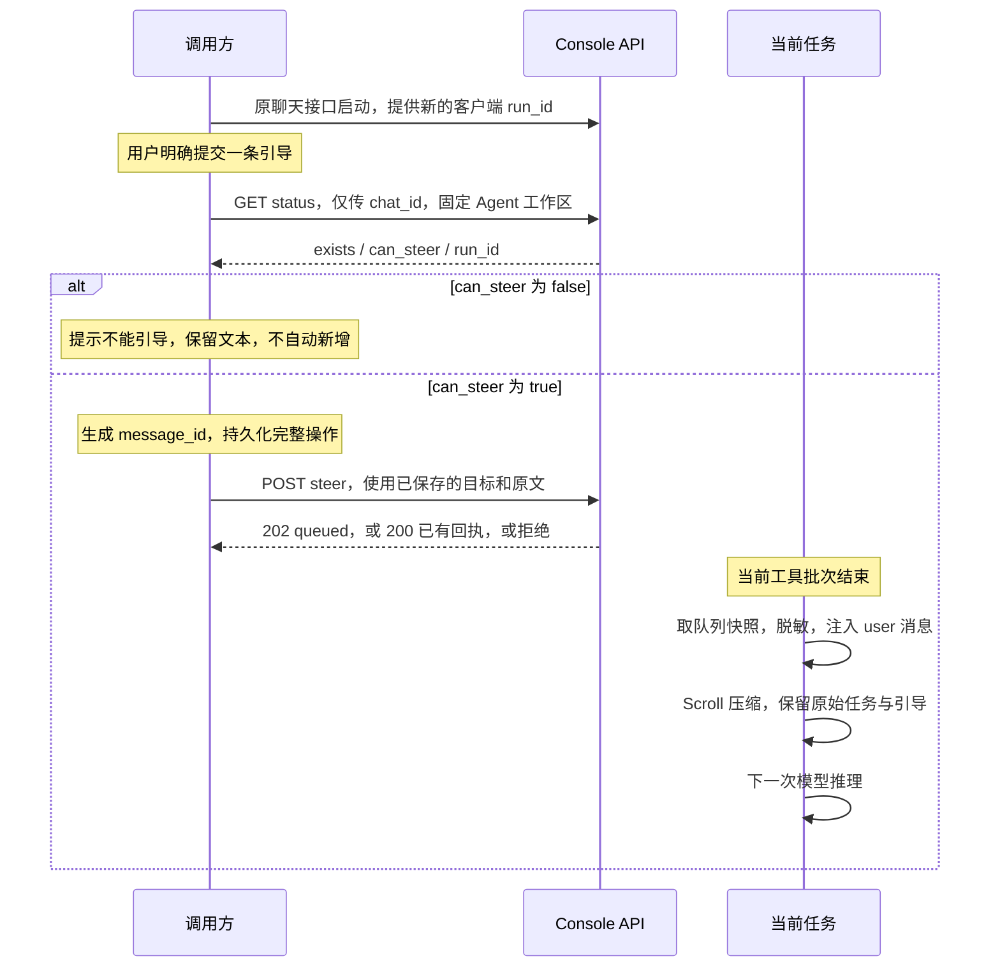

# Steer 接口与调用逻辑

本文对应当前新增接口的实际行为。Steer 指向正在执行的任务追加用户引导；示例只调用现有接口，不自动新建任务、不停止任务。

- 实现概述：[普通 Console 任务引导](steering.md)。
- 协同实现与自然推理边界：[云边端协同引导](edge-cloud-steering.md)。
- 可复用调用代码：[steer-client.mjs](examples/steer-client.mjs)，适用于 Node.js 22+ 或支持 `fetch`、`crypto.randomUUID()` 的浏览器安全上下文。

## 1. 适用条件与标识

启动任务时显式传入 `run_id`，并且本次请求进入普通执行（有效协同配置关闭）或真正进入云边端协同流程，才可能支持 steer。两种模式采用独立控制器，接口契约相同。协同配置开启但未进入协同流程的回退执行仍不支持；构建、收尾阶段也可能暂不支持。客户端以 `can_steer` 为准，提交时服务端会再次校验。

| 标识 | 来源 | 用途 |
| --- | --- | --- |
| `agent_id` | 已有 Agent 配置；状态响应也会返回 | 确定工作区，放在 `X-Agent-Id` 请求头中 |
| `chat_id` | 已有聊天记录 `ChatSpec.id` | 查询当前活动任务、指定引导所属聊天 |
| `session_id` | 原有聊天启动流程 | 传给原有聊天接口，可能与 `chat_id` 不同 |
| `run_id` | 客户端在每次新任务启动前生成，推荐 UUID | 区分同一聊天里的不同次任务，防止引导投到下一轮 |
| `message_id` | 客户端为每条独立引导生成，推荐 UUID | 在当前任务内去重，同一条引导重试时保持不变 |
| `response_id` | 现有运行时生成 | 内部响应及观测关联，不是 steer 请求参数 |

`run_id` 不代替 `chat_id`，也不改变现有 TaskTracker 按 `chat_id` 管理任务的方式。不同任务必须使用不同的客户端 `run_id`，唯一性由调用方保证，当前没有跨任务的唯一值登记表。

未传 `run_id` 的旧客户端请求仍正常执行。服务端不补生成 `run_id`，不能在运行中通过查询、重连或 steer 补开引导能力。

## 2. 公共请求约定

以下路径包含 `/api` 前缀，`BASE_URL` 只填服务根地址，例如 `http://localhost:8088`。

```http
X-Agent-Id: default
Authorization: Bearer <现有登录令牌>
Content-Type: application/json
```

沿用已有认证机制，需要认证时提供 `Authorization`；JSON POST 提供 `Content-Type`。示例显式传 `X-Agent-Id`，避免用户切换当前 Agent 后重试投向其他工作区。查询和首次提交使用同一工作区；重试使用原操作中保存的工作区。

## 3. 启动任务时提供可选 run_id

继续使用 `POST /api/console/chat`，新增顶层可选字段 `run_id`，其余参数和 SSE 响应沿用现有接口。

```json
{
  "session_id": "session-001",
  "user_id": "user-001",
  "channel": "console",
  "run_id": "5f576e5a-4726-4fbb-a532-5f43af8dd17b",
  "input": [
    {"role": "user", "content": [{"type": "text", "text": "修复配置文件读取报错"}]}
  ],
  "stream": true
}
```

| 字段 | 必填 | 说明 |
| --- | --- | --- |
| `run_id` | 否 | 不超过 128 字符的非空字符串；示例推荐使用客户端生成的 UUID；省略或传 `null` 不启用 steer |

显式传空字符串、纯空白、非字符串或超长值时，当前 Console 启动入口返回 400。服务端没有强制校验 UUID 格式。

已有活动任务时，原聊天接口可能沿用原有 attach 行为，不会因为新的 `run_id` 就额外启动任务，也不会替换正在运行的 `run_id`。新增的幂等保证针对 steer，不能把 `run_id` 当作新建任务接口的全局幂等键。

## 4. 获取当前任务状态

```http
GET /api/console/chat/status?chat_id=<ChatSpec.id>
```

查询参数只有必填的 `chat_id`，不需要 `run_id`。目标工作区使用公共请求头指定。

成功返回 HTTP 200：

```json
{
  "agent_id": "default",
  "chat_id": "chat-001",
  "exists": true,
  "status": "running",
  "run_id": "5f576e5a-4726-4fbb-a532-5f43af8dd17b",
  "can_steer": true
}
```

| 字段 | 类型 | 含义 |
| --- | --- | --- |
| `agent_id` | string | 本次查询解析到的 Agent 工作区 |
| `chat_id` | string | 查询的聊天记录 ID |
| `exists` | boolean | 当前是否存在未结束的活动任务；不是聊天记录是否存在 |
| `status` | string | `idle`、`starting`、`running` 或 `closing` |
| `run_id` | string / null | 当前已绑定 steer 状态的客户端运行标识；未绑定时为 `null` |
| `can_steer` | boolean | 此刻是否支持接收新的引导 |

常见响应组合：

| 场景 | `exists` | `status` | `run_id` | `can_steer` |
| --- | --- | --- | --- | --- |
| 普通任务已启用引导且运行中 | true | running | 客户端原值 | true |
| 旧任务未传 run_id | true | running | null | false |
| 云边端协同流程已绑定引导控制器 | true | running | 客户端原值 | true |
| 配置开启但未进入协同流程，或其他不支持的执行 | true | running | null | false |
| 普通任务已绑定引导状态，构建中 | true | starting | 客户端原值 | false |
| 普通任务已进入收尾 | true | closing | 客户端原值 | false |
| 已完成或当前无任务 | false | idle | null | false |

绑定之前的初始化阶段也可能返回 `exists: true`、`status: "running"`、`run_id: null`、`can_steer: false`。不能仅凭 `status: "running"` 判断支持引导，也不能仅凭 `run_id: null` 判断是哪一种不支持原因。

聊天记录不存在返回 404；不能把 404 当作“聊天存在但空闲”。接口不返回历史任务列表，也不返回单条引导的处理记录。

## 5. 提交一条引导

```http
POST /api/console/chat/steer
```

请求体：

```json
{
  "chat_id": "chat-001",
  "run_id": "5f576e5a-4726-4fbb-a532-5f43af8dd17b",
  "message_id": "3a714523-f2b5-4b02-abaf-afc9050fd777",
  "text": "配置文件实际在 D:/config/app.json，请使用这个路径继续修复。"
}
```

| 字段 | 必填 | 限制与用途 |
| --- | --- | --- |
| `chat_id` | 是 | string，1–128 字符，使用状态响应里的值 |
| `run_id` | 是 | string，1–128 字符，必须与当前任务匹配 |
| `message_id` | 是 | string，1–128 字符，同一条引导的所有重试必须相同 |
| `text` | 是 | string，1–16000 字符，不能全为空白；当前只支持文本 |

注意：`run_id` 在启动接口中可选，在 steer 接口中必填。`agent_id` 放请求头，不放请求体；不需要 `session_id` 或 `response_id`。

首次接收返回 HTTP 202：

```json
{
  "message_id": "3a714523-f2b5-4b02-abaf-afc9050fd777",
  "run_id": "5f576e5a-4726-4fbb-a532-5f43af8dd17b",
  "sequence": 1,
  "status": "queued"
}
```

重复提交相同 `message_id` 和完全相同文本返回 HTTP 200，返回该条记录的当前状态，不重复入队。

| 回执字段 | 说明 |
| --- | --- |
| `message_id`、`run_id` | 对应原请求标识 |
| `sequence` | 当前任务内从 1 开始的接收顺序 |
| `status` | `queued`、`preparing`、`injected` 或 `not_applied` |

| 引导状态 | 含义 |
| --- | --- |
| `queued` | 已进入当前任务队列，等待注入边界 |
| `preparing` | 正在按现有输入脱敏流程准备，尚未写入上下文 |
| `injected` | 已写入模型上下文；不代表模型已执行或已完成修复 |
| `not_applied` | 该条输入未成功写入上下文；相同 ID 重试不会将它重新入队 |

HTTP 202 只表示接收成功。不要把所有 200/202 回执都显示为“引导已执行”。当前没有独立的引导状态查询接口或新增的注入完成 SSE 事件；GET 状态只反映任务状态。活动任务结束后回执被清理，再次提交可能返回 `RUN_NOT_ACTIVE`，不能据此推断之前是否曾注入。

## 6. 错误码及客户端处理

业务错误格式示例：

```json
{
  "detail": {
    "code": "RUN_MISMATCH",
    "message": "The active execution has changed"
  }
}
```

| HTTP | `detail.code` | 原因 | 建议处理 |
| --- | --- | --- | --- |
| 409 | RUN_NOT_ACTIVE | 当前没有活动任务 | 停止原操作重试；结果可能已不可查询，不能自动转成新任务 |
| 409 | STEER_UNSUPPORTED | 当前执行没有启用 steer | 保留文本，提示用户不能引导；不自动新建 |
| 409 | RUN_MISMATCH | 当前活动任务的 run_id 已改变 | 保留原目标，不改用新 run_id 重试 |
| 409 | RUN_NOT_ACCEPTING | 当前状态不再接收新的引导 | 提示暂不接收；不自动转投其他任务 |
| 409 | MESSAGE_ID_CONFLICT | 相同 message_id 使用了不同文本 | 原条目按原文重试；修改文本应作为新的独立引导，经用户明确提交 |
| 422 | EMPTY_STEER | 文本全为空白 | 修正文本后作为新的有效提交 |
| 429 | STEER_LIMIT_REACHED | 当前任务已记录 128 条不同 message_id | 当前任务内不能靠等待或更换 ID 绕过限制 |

缺少字段、字段类型错误或长度超限时，FastAPI/Pydantic 返回 HTTP 422，`detail` 通常为校验错误数组，未必有 `detail.code`。聊天不存在时返回 404、`detail: "Chat not found"`。工作区不存在/禁用及认证错误沿用原有 404、403、401 等响应，错误体不一定采用上述业务格式。

网络断开、客户端超时、响应读取失败或 5xx 时，POST 的接收结果可能未知。若需要重试，只能使用原 `agent_id/chat_id/run_id/message_id/text`；即使重新查询发现新任务，也不能改投。遇到 409 业务错误后停止自动重试。当前任务结束后的未知结果需要保留给用户判断，不能通过换 ID 补发来“保证送达”。

## 7. 调用流程



调用方按以下顺序处理：

1. 新任务启动时生成新的 `run_id`，不要在服务端缺省时补造一个用于 steer 的 ID。
2. 用户明确选择“引导”后查询当前状态。`exists: true` 且 `can_steer: true` 且 `run_id` 非空，才能准备提交。
3. 为本条引导生成一次 `message_id`，固定查询返回的 `agent_id/chat_id/run_id` 与原文。
4. 在首次 POST 之前保存完整操作。浏览器可复用已有队列持久化；其他调用方使用自己的存储，令牌不写入操作记录。
5. 使用固定操作提交。成功显示“已接收/已注入”等准确状态，异常时保留操作，不自动改成普通消息。
6. 用户重试或执行有限次数的网络重试时，直接重发保存的操作，不重新生成 ID，不重新根据状态绑定目标。

两条不同引导分别创建两个操作、两个 `message_id`。同一条引导双击或重试复用同一个操作。服务端按实际接收顺序排序；如果 A 必须先于 B，客户端串行提交并确认 A 已接收后再发送 B。并发请求不能保证与点击时间完全一致的顺序。A 的提交结果未知时，如需严格顺序，应先处理 A 的结果再发送 B。

“空闲时发起新任务”可以是调用方的独立产品功能，但不是 steer 接口或本文示例的自动行为；`exists: true`、`can_steer: false` 时尤其不能直接当作空闲。

## 8. JavaScript 调用示例

示例客户端将“查询并准备操作”和“发送已固定的操作”分开，后者不会再次查询状态。它合并同一客户端实例内完全相同的并发提交；跨刷新、跨进程的幂等仍由保存的标识和服务端当前任务记录保证。

```javascript
import {
  createSteerClient,
  SteerHttpError,
  SteerTransportError,
  SteerUnavailableError,
} from "./examples/steer-client.mjs";

const client = createSteerClient({
  baseUrl: "http://localhost:8088", // 不加 /api
  agentId: "default",
  getToken: () => "", // 需要认证时从现有登录状态读取
  timeoutMs: 10000,
});

// 前提：已通过原流程启动任务，chatId 是已解析的 ChatSpec.id。
const chatId = "chat-001";
let operation;
try {
  operation = await client.prepareSteer(chatId, "请使用 D:/config/app.json 继续修复。");
} catch (error) {
  if (error instanceof SteerUnavailableError) {
    console.log(error.message, error.state); // 保留用户输入，不自动新建任务
  }
  throw error;
}

// 浏览器示例：先存储，再发 POST；Node 调用方替换为自己的持久化存储。
const key = `steer-draft:${operation.message_id}`;
localStorage.setItem(key, JSON.stringify(operation));

try {
  const receipt = await client.submitSteer(operation);
  console.log("回执：", receipt);
  // 将回执保存或显示为 queued / preparing / injected / not_applied。
  // 已拿到明确回执后不再为了网络补偿而自动重发。
  localStorage.removeItem(key);
} catch (error) {
  if (error instanceof SteerTransportError) {
    console.log("接收结果未知，保留原操作供重试。");
  } else if (error instanceof SteerHttpError) {
    console.log("HTTP：", error.status, "业务码：", error.code);
    // 按上面的错误表处理；不要更换目标 run_id。
  }
  throw error;
}
```

恢复一条未确认操作后重试：

```javascript
const saved = localStorage.getItem(key);
if (!saved) throw new Error("没有待重试操作");
const originalOperation = JSON.parse(saved);
// 即使当前 UI 已切换 Agent，本次 POST 仍使用 originalOperation.agent_id。
const receipt = await client.submitSteer(originalOperation);
console.log(receipt);
localStorage.removeItem(key);
```

不要对同一条未确认操作再次调用 `prepareSteer()`：它表示新建一条操作，会查询当前任务并生成新的 `message_id`，不属于幂等重试。

## 9. curl 调用

以下为 Bash 语法；Windows PowerShell 可使用 `curl.exe` 并按本地规则调整换行。启用认证时为请求补充现有 Bearer 令牌。

```bash
# 终端一：通过原聊天入口启动并读取 SSE；run_id 由客户端预先生成。
curl -N -X POST 'http://localhost:8088/api/console/chat' \
  -H 'X-Agent-Id: default' -H 'Content-Type: application/json' \
  -d '{"session_id":"session-001","user_id":"user-001","channel":"console","run_id":"5f576e5a-4726-4fbb-a532-5f43af8dd17b","input":[{"role":"user","content":[{"type":"text","text":"修复配置文件读取报错"}]}],"stream":true}'

# 终端二：chat-001 请替换为现有聊天记录的真实 ChatSpec.id。
curl 'http://localhost:8088/api/console/chat/status?chat_id=chat-001' \
  -H 'X-Agent-Id: default'

# 确认 can_steer=true 后，用查询返回的原 run_id 提交。
curl -i -X POST 'http://localhost:8088/api/console/chat/steer' \
  -H 'X-Agent-Id: default' -H 'Content-Type: application/json' \
  -d '{"chat_id":"chat-001","run_id":"5f576e5a-4726-4fbb-a532-5f43af8dd17b","message_id":"3a714523-f2b5-4b02-abaf-afc9050fd777","text":"请使用 D:/config/app.json 继续修复。"}'
```

网络失败后再次执行完全相同的最后一条请求。当前任务仍保留该条记录时，重复提交返回 200；若任务已结束则不能保证继续查到回执。

## 10. 服务端注入、生命周期及上传语义

- 普通模式收到引导时，若正在等待模型或输出思考、正文、工具参数，会结束本次生成并清理流，继续同一任务。未完成片段仅保留展示，不作为后续模型输入；已完成并落入上下文的输出保留。不会重新生成任务的 `run_id`，也不会提前结束 SSE。
- 已保存但尚未派发的旧工具会补齐明确的 `denied` / 未执行结果；参数尚未生成完整的调用直接丢弃。工具在权限检查和执行前置钩子之后再次检查，已派发的工具保留真实执行结果。`execute_shell_command` 可沿用后台执行机制让出前台；其他工具默认等待完成。协同模式仍沿用原有自然边界，不接入普通模式的抢占和工具跳过逻辑。
- 普通模式：最终推理期间到达的引导可在同一任务内触发后续推理，仍受原有迭代次数和停止门禁约束。协同模式：只在原流程自然发生的后续推理前注入，不重算 Router/Verifier、不额外启动推理；没有后续推理时标记 `not_applied`。两种模式的 202 均只表示接收，不保证已注入或已推理。
- 注入后 Scroll 保护原始任务及全部已注入引导；不能保留时显式报错，避免静默丢失。未发生注入时继续使用原 Scroll 逻辑。
- 幂等回执与排队状态只保留在当前活动任务内存。完成、失败或停止后按原有任务清理流程释放；没有十分钟缓存，也没有跨重启的持久化去重保证。
- 已注入消息随原会话保存，并复用普通任务的 session delta 上传；关联元数据包含 `agent_id/chat_id/run_id/response_id/message_id`、序号和时间。停止/异常路径也调度已注入输入，上传调度失败不阻断会话保存。未注入的排队文本不作为模型对话上传。
- 接口没有等待 Langfuse 上传完成，也不返回上传状态；使用现有异步上传器的可靠性语义。协同模式沿用 `edge_cloud_trace.v2`：已注入引导作为 user 消息进入 delta，`edge_cloud.steering` 只记录标识及状态，不包含排队原文；各阶段配置记录附带 `steering_sequence`。未启用协同引导的导出结构保持原有行为。

## 11. 从输出判断引导已进入推理

普通模式与云边端协同使用相同字段：由已包含引导的推理生成的消息，在现有 `metadata` 中增加可选的 `steer_message_id`。值直接复用 POST steer 时的 `message_id`，不新增事件或接口。

```json
{
  "object": "message",
  "id": "msg_existing_output_id",
  "type": "message",
  "role": "assistant",
  "status": "in_progress",
  "metadata": {"steer_message_id": "client-steer-message-b"},
  "content": []
}
```

- 标签取自**生成该输出的模型请求实际携带的最后一条引导**，按已有接收序号确定。同次推理携带 A、B 时只标记 B；A、B 仍按原逻辑全部注入，不删除或覆盖正文。
- 202、入队或写入上下文都不会改变正在流出的旧消息。只有后续推理实际携带了新引导，其输出才带新 ID。没有后续推理或未产生输出时，不会凭接收回执补造带标签的输出。
- 文本和多媒体消息在标签改变时使用新的输出消息 ID，避免一条消息混合两次引导之前、之后的内容。思考消息单独保存标签。未携带本轮引导时不添加该字段，历史任务的引导不会让新任务误带标签。
- 工具调用及工具结果沿用发起调用的那次推理的标签；工具运行时收到的新引导不会修改旧工具结果。协同 Router/Verifier 的模型输出、决策工具和结论沿用各自推理的标签，不触发额外推理或重算。阶段开始提示不带该字段。
- 字段位于 `message.metadata`。消息开始、消息完成及最终 `response.output` 中保留相同值；后续 `object=content` 增量继续通过既有 `msg_id` 关联消息，前端不应依赖每个内容增量都有 metadata。
- 前端按输出消息 ID 保存标签，通过 `steer_message_id` 关联提交记录；同次推理合入多条引导时，只能从输出字段读到最后一条的 ID。该字段表示生成依据，不表示模型正确执行了要求，也不表示任务或上传已完成。
- 原生会话、可选协同展示会话、历史读取和 Langfuse delta 沿用现有 metadata 保存及转换流程。停止时已流出的部分输出也保留原标签；上传正文继续执行原有脱敏，字段只记录关联 ID。

历史接口沿用原有包装：原生 metadata 位于返回消息的 `metadata.metadata` 内，因此读取历史记录使用 `message.metadata?.metadata?.steer_message_id`；实时 SSE 与最终 `response.output` 使用 `message.metadata?.steer_message_id`。不改变历史接口结构。

前端处理逻辑示例（接在现有 SSE 解析之后）：

```javascript
const outputSteer = new Map(); // 输出 message.id -> 该输出使用的引导 ID

function onStreamObject(event) {
  if (event.object === "message") {
    const id = event.metadata?.steer_message_id;
    if (id) outputSteer.set(event.id, id);
    renderMessage(event, outputSteer.get(event.id));
  } else if (event.object === "content") {
    renderContent(event, outputSteer.get(event.msg_id));
  } else if (event.object === "response") {
    for (const message of event.output ?? []) {
      const id = message.metadata?.steer_message_id;
      if (id) outputSteer.set(message.id, id);
    }
    // 继续沿用已有的 response 合并逻辑，保留各 message.metadata。
  }
}
```

不要在收到 steer 的 HTTP 回执时，把当前或之后收到的所有输出统一改成该 ID；当前模型请求和工具批次可能仍属于之前的输入。

## 12. 普通模式的中断、协议及存储

- 中断的显示消息使用原 `message.id` 收尾；未完成消息的 `status` 为 `cancelled`，并带 `metadata.steer_preempted=true`。这只结束该输出片段，整体任务继续。片段保留它原先的 `steer_message_id`；新生成输出才使用本次实际注入的最后一个 ID。
- 多条引导仍按顺序全部注入。同一 `message_id`、相同正文的重试不增加序号，也不会再次打断模型。不同的新引导可再次打断后续生成，继续使用原有迭代上限和停止门禁。
- 新引导在 Scroll 前注入，原任务及所有已注入引导继续受保护。后台工具的完成通知也在普通模式的下一次压缩前消费；任务结束后到达的后台结果沿用原有下一轮取回机制，不自动启动新推理。
- Qwen / DeepSeek 的 OpenAI 兼容协议按每次完整生成保留真实 `reasoning_content`，与对应工具调用、结果配对；不把未完成思考拼入正文，也不使用空格伪造缺失思考。既有 `relay_reasoning_content` 配置仍生效，历史记录若缺少模型强制要求的思考内容，不能由 steer 自动恢复。
- GPT Chat Completions 不发送 `reasoning_content` 扩展；Responses 协议保存已完成的原生 reasoning item（包含可用的加密状态），并在后续请求中重放。仅在普通模式的请求视图中适配，原生上下文不做格式拆分。
- Responses 的原生推理摘要若被脱敏或压缩改写，不能再重放含原文的恢复副本；服务端会明确报错，避免通过恢复字段重新发送原文。
- session 使用现有 context view 机制保留中断片段；加载时恢复合法模型上下文，防止片段重新进入推理。Langfuse delta 包含引导、真实工具结果和中断展示记录；`model_requests` 的普通请求增加状态与引导关联。中断用 `steered` 标识，未返回 usage 时不估算 token。
- 上传继续走现有脱敏链路；加密 reasoning 和本地恢复数据从普通模式的上传副本中剔除。本地 session 保留必要的协议恢复状态，继续沿用现有本地存储策略。
- 本次没有新增或改变 HTTP 接口。没有 `run_id` 的旧客户端、开启云边端协同的请求维持原执行路径。

协议测试使用本地模拟响应验证请求结构；具体模型和兼容网关仍需使用实际配置做联调。

## 13. 切换模型和工作区热重载

同一 `agent_id` 的新旧 Workspace 复用同一个 TaskTracker。运行中的任务保留原 `chat_id`、客户端 `run_id`、引导幂等记录和 SSE 缓冲，因此模型切换、配置重载后，状态查询、steer、停止和重连仍可定位原任务。不同 Agent 的任务表继续隔离。

运行中的任务继续使用原 Agent 与模型；新任务使用新 Workspace 的配置。同一 chat 已有活动任务时仍按原规则附着，不重复启动。请求若在重载前取得旧 Workspace、重载后才登记，则重新解析当前 Workspace 后登记；不向已退休实例启动新任务。

旧实例仅等待自己所属的任务和已经提交的定时任务，不受新实例后续任务影响。等待超时只记录日志并继续等待，正常热重载不会在 60 秒后关闭仍被任务使用的资源。定时器按既有任务进度交接，避免旧、新调度器重复触发。

本次调整不新增 HTTP 参数，不改变协同与非协同的引导策略，也不改变 session、Langfuse 和脱敏的格式与处理流程。
