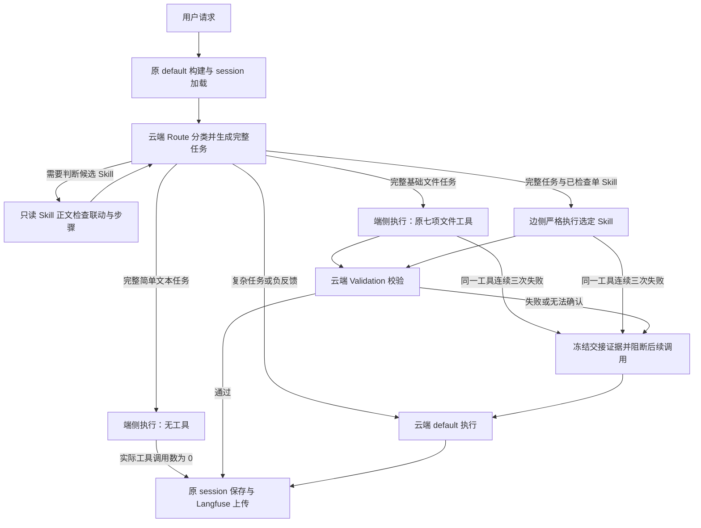

# 云边端大模型多 Agent 协同方案

> 版本：V3.1 · 日期：2026-10-16 · 定位：复用现有 Skill 与工具机制的 default Agent 执行层扩展

## 1. 范围与核心约束

本方案扩展现有云端框架的 default Agent 执行入口。开始时由 **云端模型运行 RouterAgent**，判断完整任务适合云、边、端哪个执行角色；后续推理和工具调用使用所选角色的模型与工具范围。需校验任务完成后，由 **云端模型运行 VerifyAgent** 根据执行过程和结果独立判断是否完成；其有效提交的 `passed` 是唯一验收结论，通过就接受结果，未通过或无法取得有效结论时由云端基于已有证据继续处理。

RouterAgent、VerifyAgent、CloudAgent 直接复用原 Agent 已加载的模型对象，与关闭协同时相同，包括模型服务、模型名、凭据和生成/重试设置。现有 ProviderManager 继续从项目 `.devco_paw.secret/providers` 加载服务配置，并遵循原 Agent 的 active_model/provider 选择。DeviceAgent 和 EdgeAgent 分别配置自己的模型连接，互不共享、互不回退；某侧未配置时，其任务交 CloudAgent。

三层分工固定为：**DeviceAgent 处理简单无工具任务及配置轮数内的基础文件操作（默认最多 2 轮）；EdgeAgent 严格执行单 Skill；CloudAgent 处理复杂任务、所有创造性任务、多 Agent/多 Skill 联动、用户负反馈和失败接管。** 不设无 Skill 的边侧通用工具分支。

Skill 沿用现有 `SKILL.md`、原启用配置、session Skills 和技能池发现机制，不要求增加依赖 JSON、专门的 Skill 白名单或每个 Skill 的工具配置。Route 在分发边侧前通过只读 `Skill` 工具检查真实正文中的跨 Skill、Agent 联动和复杂工作要求；边侧重新读取选定 Skill，严格按其流程选择已有工具并执行。

五个角色是运行时职责，不是五个持久化 Agent。整个请求始终使用原 default 身份、同一个 Agent 状态和上下文管理器，不为各执行角色创建独立 workspace、session 或历史树。

云端 Route 根据可用上下文与最新用户输入，生成可独立执行的完整 `execution_task`。端侧、边侧模型仅接收该任务、完成条件及本轮执行记录，不接收原始历史、历史摘要、Scroll 索引或最新问题的单独副本。原始会话始终保留在 default 状态中供云端使用；云端兜底额外获得前一执行角色、下发任务、已调用工具及结果证据。

以下原有机制沿用：session 读取与保存、Langfuse 上传链路、请求与工具结果脱敏、上下文压缩和 Scroll 归档、工具审批与文件访问范围、默认云端模型配置、原有命令与模式分流。原生 session 保留 default 系统提示词和统一执行历史，云、边、端执行产生的工具调用与结果按原会话格式保存。云边端 Langfuse 本轮记录采用兼容普通模式的 delta 消息结构，角色提示词与工具定义仍按原配置记录单独上传；已展示的 Router/Verify 过程只进入上传副本或显式开启的本地过程视图，不进入下一轮模型上下文。

本扩展的目标是减少可由边端执行的任务所需的云端 Token，而不是消除云端调用。每次进入协同流程仍有云端路由；需要校验时仍有云端校验，需结合这两部分开销衡量收益。模型连接可以指向本机、局域网或兼容服务；角色名称本身不证明模型实际部署位置。

## 2. 角色与权限

| 角色 | 模型与职责 | 任务输入 | 工具范围 |
| --- | --- | --- | --- |
| RouterAgent | 既有云端模型；生成完整任务，读取候选 Skill，检查跨 Skill/Agent 联动并选择执行层 | 原可用历史、历史摘要和最新用户输入 | 只读 `Skill`，以及原已提供的 `list_skills/get_skill_count`；检查后一次结构化路由提交，不执行用户任务 |
| DeviceAgent | 独立端侧模型；简单无工具任务及配置轮数内的基础文件操作，默认 2 轮 | 完整 `execution_task`、完成条件及自己的本轮执行记录 | 无工具文本分支为空工具列表；文件分支保留读取、写入、编辑、追加、复制、移动、建目录七项工具 |
| EdgeAgent | 独立边侧模型；严格按照 RouterAgent 选定的一个现有 Skill 执行 | 完整 `execution_task`、完成条件、选定 Skill 及自己的本轮执行记录 | 原授权工具体系，排除历史召回、Skill 创建、其他 Skill/Agent 和绕过边界的批处理入口 |
| CloudAgent | 原 default 云端执行模型；复杂任务、多 Skill、多 Agent、创作、负反馈和失败续做 | 原可用历史与最新问题；接管时加上边端任务、执行角色及工具证据 | 原工具与 Skill，受原任务权限限制 |
| VerifyAgent | 既有云端模型；按下发任务与完成条件校验实际成果 | 完整下发任务、完成条件、本轮最终回答、执行角色、Skill 证据（仅边侧：名称、来源、目录、`SKILL.md` 路径、`references/scripts` 路径清单、执行时加载的正文，可调用只读 `Skill` 工具复核）及真实工具结果 | 只提交校验结论，不执行或修改任务 |

端侧工具为 `read_file`、`write_file`、`edit_file`、`append_file`、`copy_file_or_dir`、`move_file_or_dir`、`create_directory`。端侧不开放 Shell、网络、Skill 或 Agent 派发工具。创造性任务不因篇幅短或工具少而交端侧。边侧的文件、Shell、脚本或 MCP 等工具由模型根据 Skill 正文选择，工具可见性和授权仍由原框架控制，不因模型切换增加访问权限。

## 3. 云端路由与执行

### 3.1 路由协议

Route 初始读取最新请求、必要历史、当前可用端侧工具和原框架已注册 Skill 的名称、描述。名称与描述只用于寻找候选，不能作为无依赖的证明。考虑交边侧时，Route 必须先调用只读 `Skill(skill="真实名称")` 读取正文，再调用一次 `submit_route_decision` 返回最终分类。技能池仍按原 `list_skills` 分页发现，不建立新的索引配置：

| task_type | 执行 Agent | 条件 | VerifyAgent 校验 |
| --- | --- | --- | --- |
| `device_text` | DeviceAgent | 简单问答、给定内容翻译/摘要/改写或解释；不需要工具，不是创造性任务 | 不校验，直接返回 |
| `device_tools` | DeviceAgent | 简单基础文件读写，预计轮数不超过配置上限，默认 1～2 轮 | 必须校验 |
| `edge_skill` | EdgeAgent | 读取正文并检查联动后，确认单 Skill 可以独立完成 | 必须校验 |
| `complex_or_negative` | CloudAgent | 复杂任务、创造性任务、多 Agent/多 Skill 联动、负反馈或兜底 | 不校验 |

同时返回 `need_tools`、`need_verifier`、`estimated_tool_rounds`、`completion_conditions` 和简短原因。端侧文件任务的估计轮次必须为 1 到本次 `device_max_tool_rounds` 的整数；超过上限、无法估计或缺少估计时交 CloudAgent。一次模型响应中的一批工具调用计一轮；达到上限后允许只生成最终回答，若仍返回工具调用则在执行前阻断并交云端。Router 提示词、Device 提示词与运行时硬限制均使用同一配置。边侧路由的 `skill` 必须填写本次 Route 实际成功读取的精确名称；端侧、云端留空。运行时将未读、读取失败、留空或改选未读 Skill 的边侧决定回落到云端。`required_tools` 无法预先确定时可留空，它不作为每个 Skill 的工具依赖声明。路由仅接受上表四种分类和 `device/edge/cloud` 三种执行目标。

端侧和边侧路由还必须提供非空 `execution_task`：从当前可用上下文和最新问题中解析指代，整理目标、相关事实、已确认决定、精确输入、路径/参数、操作限制、输出格式与验收要求。任务应可独立执行，不写“参考上文”，不复制无关历史，也不能概括掉翻译、计算等工作必需的原始数据。Route 接收现有可用上下文和历史摘要，不再按字符数截掉历史开头；若必要信息已不在可用上下文中、附件无法可靠转述/引用或无法形成完整任务，则交云端。未提供完整任务时运行时也交云端，不以原始会话作为边端的备用输入。该字段是路由结果，不是新增用户配置。

路由提示词明确按优先级判断：先将复杂任务、所有创造性任务、用户对已有结果的负反馈和多 Skill/Agent 任务交云端；剩余任务若完整匹配一个 Skill，则交边侧；不需要 Skill 的简单文本和基础文件操作交端侧。需要非端侧工具却没有匹配 Skill 的任务交云端，不能作为边侧通用工具任务执行。

Skill 检查由云端 Route 根据真实正文判断，重点检查本次任务必须执行的跨 Skill 调用、Agent 派发/协调、复杂规划，以及前置条件、完整步骤和验收要求。正文中的可选联动分支只在本次任务实际需要时考虑。同一 Skill 的普通工具、脚本、库和资源文件依赖不等同于多 Skill/Agent；不能仅因存在这些依赖而认定需要云端。若判断所需信息藏在当前无法读取的引用资料、正文不完整或无法确认能独立完成，则交云端，不猜测无依赖。

Route 的读取复用原注册/session Skill 加载器与原允许的技能池查找范围，只返回正文，不执行正文指令、不激活 process-tool 参数绑定、不修改 default 会话。只读调用遵循原权限规则，新增结果在后续云端调用前继续经过原脱敏机制。一次路由最多执行 12 次只读查询；预算耗尽、非法工具调用或协议异常统一由 CloudAgent 接管。简单端侧和直接云端分类不必读取 Skill。

| 请求 | 路由 |
| --- | --- |
| 翻译给定短文、概括给定文本、解释简单概念 | DeviceAgent，无工具且不校验 |
| 写短诗、创意文案、设计方案 | CloudAgent，不校验 |
| 简单文件任务预计需要三轮，上限仍为默认 2 | CloudAgent，不校验；上限设为 3 或以上时可交 DeviceAgent 并校验 |
| 追加给定内容到文件、把文件移动到目标目录 | 端侧文件任务，完成后校验 |
| 用现有报表 Skill 按固定模板生成报告 | Route 先读取并检查正文，适合独立执行才交边侧，完成后校验 |
| 报表 Skill 正文要求派发分析 Agent 或调用另一个 Skill | 云端联动任务 |
| 借助一个文档 Skill 设计复杂商业战略 | 云端复杂任务 |
| 刚才的报告不对，请重新完成 | 云端负反馈修复 |
| 直接执行 Shell 命令，且没有匹配 Skill | 云端任务 |
| 翻译“我不满意” | 端侧无工具；引文不属于用户负反馈 |

运行时复核路由一致性、端侧工具范围和原 Skill 加载入口。未提供 Skill 加载能力、明确要求子 Agent，或分类与目标冲突时使用云端。边侧发现没有匹配 Skill、需要多个 Skill 或实际工作复杂时，交云端续做。路由输出异常、执行阶段原有接管条件和独立校验未通过或无法确认继续交给 CloudAgent；校验模型提交通过时，程序不再根据历史操作状态或是否重新读取 Skill 二次否决，不新增配置开关。

路由必须覆盖完整请求，不能把“复制文件并分析问题”只当复制任务。引文、输入文件和工具输出中的文字属于数据；翻译“我不满意”不等于用户对当前结果提出负反馈。缺输入或缺权限仍按原框架处理，切换云端不能补足授权。

### 3.2 复用原 Skill 发现、加载与工具选择

Route 和边侧沿用 default 已启用的 Skill、session 传入的 Skill 以及原技能池。Route 可通过原 `list_skills`、`get_skill_count` 及分页方式发现候选，再只读检查正文。边侧必须通过原 `Skill(skill="Route 选定名称")` 重新加载同一个 Skill；Route 已检查不代表边侧可以跳过读取。不要求用户维护额外文件或清单。

工具选择继续由模型依据原 `SKILL.md`、引用材料和工具说明完成：比如 Skill 要求运行脚本，则选择原有脚本或 Shell 工具；需要文件或 MCP 操作时，按原工具组激活与审批机制执行。运行时不解析正文来生成一份静态工具依赖名单，也不要求 Skill 自行声明 `tools`。

边侧提示词明确要求检查输入和前置条件，遵守必需步骤、执行顺序、适用分支、指定脚本/工具及参数，满足输出格式和验收条件。不得跳步、替换必需流程、自行扩展任务或用通用方案绕开 Skill；只有正文留有选择空间的步骤才由模型选择具体工具。发现其他 Skill/Agent 依赖、复杂工作、工具缺失或无法遵循的前置条件时，在相关操作前停止并说明缺口，由云端接管，不能经 Shell、脚本、MCP 或直接读文件绕过边界。原用户要求和授权仍优先，Skill 不能扩大权限。

边侧工具视图复用原工具解析器、MCP 客户端及权限包装；动态激活的工具同样受单 Skill 边界检查。保留原 `process-tool.json` 参数绑定等已有机制，它们是原框架的可选能力，不是新增准入条件。

运行时允许必要的 Skill 发现及工具组激活；业务工具调用前必须已成功加载选定 Skill。边侧排除 `recall`、`recall_history`、`recall_history_python`、`get_historical_tool_result`、`memory_search`，以及 `material_skill/materialize_skill` 等 Skill 创建入口；后续激活的工具组也遵循相同过滤。缺少上下文时交云端，不能通过 Shell、脚本或直接读取会话/Scroll 文件恢复原始历史。

若未读取 Skill 就执行业务工具，触发 `EDGE_SKILL_NOT_LOADED`；首次加载其他 Skill 触发 `EDGE_SKILL_MISMATCH`；加载后尝试第二个不同的 Skill 触发 `MULTIPLE_SKILLS_REQUIRED`。这些加载被阻断，任务交云端。对正文的语义判断和严格执行由提示词约束，运行时硬检查选定 Skill、加载前置及单 Skill 边界；不宣称仅靠读取记录就已证明不存在隐藏依赖。Validation 根据实际证据进一步检查任务转述是否遗漏或改变原要求，以及 Skill 必需流程、输出和验收条件；转述错误、跳过或替换必需步骤不能通过。

### 3.3 边端输入与原 Scroll 流程

输入限制在模型适配层实现：default 的原始上下文、用户最新消息和历史摘要仍由同一个 Agent 状态持有；端侧模型请求只保留 DeviceAgent 自身的精简运行约束、生成的完整任务、自己本轮的推理/工具调用与结果，该约束不含任何 Skill 清单或 Skill 流程，也不告知后续是否由 VerifyAgent 校验、是否需要 CloudAgent 接管——这些只由 RouterAgent 与运行时决定；边侧模型请求保留原系统提示词及本层约束、生成的完整任务及本轮执行记录。历史、旧轮次回答、Scroll 索引和额外历史召回信息均不下发。生成的任务消息只用于模型输入，不替换 session 中真实用户消息，也不建立新的会话树。

端、边、云执行均继续通过原 `AgentExecutor` 和 AgentScope ReAct 循环，推理前调用原 `compress_context`，沿用原 Scroll 管理器、写穿归档、触发比例及压缩步骤，不手工调用另一套压缩流程，不清空或交换 `state.context/state.summary`。端侧、边侧模型使用 SDK 默认配置，不额外指定上下文长度或采样参数；可通过各自的 `max-tokens` 启动参数独立指定最大输出，未指定的生成参数由模型服务决定。它们不要求配置上下文与最大输出的 C - O 请求预算，也不套用云端这项预算检查。云端继续使用原配置及预算检查。边端 token 计数与实际发送采用同一任务输入，避免对未下发的历史计费或漏算任务；发生本轮工具结果压缩后，仍只下发本轮记录，若缺少完成工作所需证据则交云端。原 Scroll 可选标题生成和原生结构化压缩如果需要读取历史，继续交原云端模型处理。

## 4. 主流程



default 只构建一次，原生命周期 Hook 仍先后运行。执行期间临时切换模型、工具范围、运行说明和迭代上限；完成、异常或取消时恢复 default 的模型、工具与系统提示词。原上下文管理器和压缩配置不重建。

DeviceAgent 文件分支在模型适配层按本次 `device_max_tool_rounds` 限制带工具调用的响应，包括流式响应，默认上限为 2。达到上限后将工具选择设为禁用，允许正常回答；模型仍发出新的工具调用时，在工具实际执行前触发 `DEVICE_TOOL_ROUND_LIMIT` 并交 CloudAgent。多项文件操作若位于同一响应内仍计一轮。原 default Agent 的总体执行预算若更严格则继续遵循它。

端侧无工具分支实际没有任何可执行工具；正常结束后再次检查是否出现工具调用。端侧使用工具和所有边侧任务均需云端校验。校验器不修复任务；仅以有效提交的 `passed` 判断是否接受，通过则正常收尾，未通过或无法确认则云端续做。校验模型的原始对话仍不进入会话。流式事件继续使用原 Envelope 与前端协议。

RouterAgent 与 VerifyAgent 的函数提交统一使用 `tool_choice=auto`，由模型自行选择只读检查或提交函数。DeepSeek V4、Qwen3 等思考模式只接受 `auto`/`none`，不接受 `required` 或指定函数对象，强制点名会直接报错。模型只输出文本而未提交、或结论格式无效时，按路由失败或校验无法确认处理，由 CloudAgent 续做，不做额外重试。

VerifyAgent 以 RouterAgent 下发的完整任务和完成条件为验收依据，不接收原始历史、历史摘要或最新问题的单独副本，不重新解释历史或审核任务转述。本轮最终回答单独提取；实际工具参数、终态和结果通过执行日志提供。边侧校验额外提供结构化 Skill 证据：名称、来源、目录、`SKILL.md` 完整路径、`references/` 与 `scripts/` 下的相对路径清单（超过 200 项时标记截断）、加载记录序号，以及执行时实际加载的正文；正文在证据中只保留一份，对应的 `Skill` 调用结果折叠为引用标记。校验器先按正文整理步骤与验收清单，再核对工具参数中的路径是否指向 Skill 目录下的正确文件；必读引用没有对应读取记录、正文缺失或被截断时按证据不足判定失败。边侧校验还复用路由的只读 `Skill` 工具重新读取选定 Skill 正文，与注入内容对照；不新增文件读取工具，`references/scripts` 是否被边侧读取仍以执行日志为准。端侧不涉及 Skill：不提供 Skill 证据，也不要求或检查 Skill 加载、步骤、目录与引用文件，只按任务、完成条件、最终回答和文件工具记录校验；任务要求文件操作却没有对应工具记录时判失败。历史理解与任务整理完整性由 RouterAgent 负责；校验器检查成果、必需步骤、遗漏和副作用，任务含糊、缺少必要输入或证据不足时判定失败并说明缺口，不猜测或新增要求。

校验允许正常纠错：VerifyAgent 结合全部工具历史、后续恢复证据、最终要求、必要步骤和遗留影响自行判断。程序直接接受其有效 `passed`，不再叠加文件操作状态、历史失败、置信度阈值或 Skill 重读记录的验收条件。Skill 只读工具及提示词中的复核要求继续保留。执行记录、文件操作副作用状态及重复写入保护继续服务于证据保留和云端接管，执行阶段的限制、权限、取消和实际文件交付流程保持原样。

## 5. 执行阶段失败阻断与云端续做

协同请求复用已启用的 Scroll `conversation_history` 与 `recall_history`，不自动切换上下文策略或新建存储体系。新增适配仅处理端侧或边侧执行后，通过 user 消息投喂给 VerifyAgent 或 CloudAgent 的协同上下文；原始用户消息、原系统提示词和同一 session 的既有历史处理保持原样，原有 Scroll 继续负责历史总量的预算与压缩。云端仅在本轮接管 user 消息连同系统提示词、工具定义和最大输出超过模型配置预算时，将完整接管正文保存为 `kind=edge_cloud_context` 的历史记录，以 user 消息副本中的记录编号和召回参数替代模型侧大段正文，非文本块保留。未超限的接管消息保持原样，不附加读取提示；直接路由到云端也不安装新增包装。快照使用本轮标识和内容哈希去重，不进入普通历史全文搜索。

VerifyAgent 每次模型调用前按实际云端模型的上下文和最大输出配置统计完整 messages 与 tools。完整校验输入可容纳时维持原样；超限时将已脱敏的完整 JSON 保存到同一表，并在 user 消息的 `history_context` 中提示按需调用只读 `recall_history`。该读取入口只接受本次校验提供的记录编号，支持 `op=expand, lo=hi=<seq>, json_path, offset, max_chars`：`json_path` 可选择 `/execution_task`、`/completion_conditions`、`/final_answer`、`/skill` 或 `/tool_results`，`next_offset` 标记后续分页。Skill 读取结果或召回结果增长后再次检查预算，已读正文可折叠为可回读引用，当前分页缩短时同步调整游标，不静默丢失尾部。历史读取最多 32 次，原 Skill 读取预算保持不变；必要输入仍无法容纳时沿用无法取得有效校验结论的异常路径。验收仍只采用 VerifyAgent 提交的 `passed`。

单条工具文本的截断独立于整体模型预算处理。仅在本轮端侧或边侧工具实际调用期间，观察共享文本截断入口；截断发生时将截断前本次实际取得的文本保存到同一表，并在该调用的 `text_evidence` 中附加数据库编号、`json_path=/text` 的分页参数、文件路径及读取范围。工具原来的输出和截断方式保持原样，观察范围在向外交付工具结果前结束，云端自身调用和协同关闭时不启用。即使校验输入整体可容纳，VerifyAgent 也能从 user 输入中的这项证据按需读取缺失部分。云端接管中被缩短的长工具入参或省略的长结果同样提供完整调用记录的数据库引用；`/arguments` 保留写入、编辑的完整入参，`/result` 保留实际返回，已有 `read_handoff_artifact` 仍可使用。接管消息同时传递截断前文本引用，不会把短摘要误认为全部证据。本次读取范围不表示整份文件，写入入参不表示写入已成功；上游本就未提供的内容无法由快照恢复。数据库保存失败时明确标记证据不可用，保持实际工具结果及既有接管路径，不另加程序验收规则。

上述提示不写入系统提示词。协同关闭时不安装历史输入适配或分页包装，普通 `recall_history`、权限、保存、验收、接管和文件交付逻辑保持原样；没有现成 Scroll 历史库或召回工具时保留原执行路径。协同云端不携带分页参数的召回调用仍委托原工具执行。

### 5.1 同一工具连续三次失败

本次边端执行中，运行时按实际工具执行顺序记录终态。最近三次实际调用为相同工具且均明确失败时，触发 `SAME_TOOL_3_FAILURES`。改变参数不会改变工具身份；一次成功清零；切换工具后按新连续序列计数；权限拒绝不作为已执行失败。

工具返回明确的 `ERROR` 时，在向原工具调度器交付结果前完成终态记账并释放执行锁；调度器提前结束结果流消费不会将其改记为 `UNKNOWN_TOOL_OUTCOME`，收尾也不会重复计数。一次 `read_file` 文件不存在错误允许端侧或边侧继续创建文件；真实中断、未完成的结果流仍按状态未知处理。修复仅位于协同执行包装层，关闭云边端协同时不安装该包装，继续使用原工具链路。

边端工具调用串行执行。第三次失败的结果先进入工具证据，再阻止新的边端推理与工具执行，禁止第四次实际操作；同一模型响应中排队的后续调用也不能绕过。边侧沿用 default 的既有执行预算，不增加每个 Skill 单独配置的调用配额。执行结果中断或不明使用 `UNKNOWN_TOOL_OUTCOME`，云端必须先核对受影响资源，不能当作未发生写入。

这一强制规则独立于原有 FailureLoop 建议机制，不修改原恢复提示或压缩算法。当前实现的计数作用域为一次 Runtime 请求；不新增跨进程执行租约、持久化任务调度服务或断点自动接管机制。进程异常后的会话恢复沿用原框架，不能将请求内计数视为跨重启任务状态机。

### 5.2 保留执行上下文

云端接管沿用同一个 default Agent 的状态，保留边端已执行的工具调用、返回结果、会话进度和 Scroll 归档状态。它不从空白状态重新执行原始要求，也不把原请求作为新的用户轮次重复追加到历史中。被阻断但未执行的排队调用会先补齐协议终态，再开始云端推理。

接管时以最新一条 user 消息下发交接说明，明确云端当前职责、此前交给 `device` 还是 `edge`、下发的完整任务、接管原因、已知缺口，以及实际调用过的工具名称、参数、终态与实际结果。边端执行轮次不作为 assistant 消息留在会话历史中，其调用与结果全部折叠进这条交接说明。短结果直接内联；超过 600 字符的结果只保留终态、字符数与引用，不放入可能被误读为完整内容的截断片段，需要时通过本次只读交接引用读取原文。用户本轮请求保留为上一条 user 消息，交接说明不重复其正文。

交接说明以 user 消息注入并随会话保存，它是执行证据而不是新的用户要求：不冒充用户指令，不保存 Route/Validation 的完整对话，也不保留一个与云端同名、含外部工具调用的 assistant 轮次，避免云端把他人执行误认为自己的历史。云端按原始请求与已有证据自行判断如何继续，保留有效结果；遇到部分成功或状态未知时先查询当前状态。原文件写操作日志继续阻止完全相同操作的盲目重放；它不是所有工具副作用的事务回滚系统。

系统提示词始终保持会话原始提示词，不注入角色声明或接管说明。Router 直接选择 `cloud` 时属于正常云端执行，不产生交接说明、不改写系统提示词，用户输入原样下发。

### 5.3 只读引用接口

实现提供 `read_handoff_artifact(ref, view)`：

- `handoff://<flow_id>/manifest@v1`：原始要求、下发的完整任务、前一执行角色、完成条件、失败原因、实际加载的 Skill 名称、工具操作清单、结果引用及副作用摘要。
- `trace://<flow_id>/call-<序号>@v1`：一次实际工具操作的参数、终态与结果。
- `view="metadata"` 返回轻量信息，`content` 或 `result` 返回所引用证据。

引用在本次云端接管期间绑定到不可变快照；拒绝读取其他请求的引用，不把任意路径解析成本地文件，不额外取得文件或网络权限。该接口的返回结果和其他工具结果一样，经过原执行器的脱敏流程。当前引用为请求内对象，不承诺跨重启继续解析；持久化执行证据仍以原 session/归档为准。

### 5.4 取消

用户取消继续走原 Runtime 的取消、错误 Hook、资源清理和 session 保存路径。边端模型或工具被取消时不得启动云端接管或结果校验；已产生的文件副作用不自动回滚。未完成工具调用的状态按原框架记录，不宣称未知写入已撤销。

## 6. Session、Langfuse 与脱敏

### 6.1 统一会话

整个请求的 `agent_id`、`session_id`、工作区、存储用户身份与观测用户身份不随执行角色变化。SessionLoadHook 与 SessionSaveHook 仍负责原位置的读写，正常用户消息、助手回答和工具调用/结果采用原格式。

default 系统提示词是唯一保存的系统提示词。端、边运行限制只临时用于推理；云端接管说明作为最新 user 消息注入并随会话保存。模型请求快照中的系统提示词仍规范化为 default 系统提示词，不为云、边、端建立新的会话分支。默认保存逻辑不将 Route/Validation 的客户端过程写入 default 会话；可通过独立的过程存储开关保存同一会话的展示副本，见下文。

云、边、端执行期间的工具调用及结果必须完整保留；切换云端时不能丢弃失败证据，也不能重置上下文管理器。保存内容不依赖“最后由哪个角色完成”。

### 6.2 上传与脱敏

Langfuse 上传仍由原 session delta 保存回调触发，沿用原开关、凭据、用户身份处理、上传调度、trace ID 和脱敏器。只有实际进入云边端协同且上传开关生效时，才创建独立的本轮上传收集器；本地过程存储开关不控制上传。非协同请求继续原有上传分支，包括只保留最后一次模型配置和过滤结构化 Thinking 的规则。

协同本轮 Input 与普通模式使用相同六个字段：`session_id`、`agent_calls`、`delta`、`session_skills`、`model_requests`、`edge_cloud`。不再发送 `stage.*`、`stage_count` 或主记录中的 `stages` 列表。`delta` 按首次展示顺序保留本轮输入及实际发往客户端的正文、Thinking、工具调用/结果和已放行附件；流式分片与完整快照合并，正文中的 Agent/model 标识原样保留。过程展示关闭时不补造未显示的 Router/Verify 过程。正常情况下每条已知角色消息在既有 metadata 中带 `model_ref`，外层 name 仍沿用原 Agent。不得将本地视图的上下文恢复 metadata 上传。

`model_requests` 按 Router、Device、Edge、Verify、Cloud 各保留一条最后实际请求的模型配置，只记录实际发生的角色。同一角色多轮调用不增加条数，不同角色使用同一模型仍分别记录。每条配置含 `agent`、模型/Provider、stream、tool_choice、生成参数及 `config_ref`；已有云端用量随相应角色保留。`config.prompt/config.tools` 的生成、配置 key、首次出现信息、去重表、trace ID、发送与 flush 流程保持原样，不将工具 schema 或系统提示词重复塞入本轮正文。

本轮格式标识 `content_format=session_messages.v1` 位于 span metadata，不增加 Input 顶层字段；Output 仍为上传状态和消息/委派数量。`agent_calls` 继续表示真实委派工具调用，Router/Verify 不计为委派；`session_skills` 继续表示会话注入技能。协同保留原有思考上传口径，并使用原脱敏器处理 delta 正文、Thinking、工具结果、模型参数及配置；工具名称、调用 ID 和输入参数沿用原协议保护规则。脱敏失败仍跳过上传，普通上传分支不变。

原请求和历史在送入云端路由及执行模型前继续接受已有敏感信息检查；校验输入中的下发任务、完成条件、最终回答和工具证据也经过原脱敏链路。边端工具返回值和只读交接资料通过原执行器处理。切换模型不能绕过脱敏确认、工具审批或原文件授权。连接参数仍从请求上下文中剥离，不进入后续工具或 Agent 转发。

Route 生成的完整任务在发给边端模型前同样经过原脱敏入口。session 状态保存真实用户消息和统一执行历史；模型请求快照反映实际下发的任务输入，系统提示词继续规范化为 default 提示词。Route 的控制对话不保存。

## 7. 模型配置与 Chat 接口

### 7.1 五个命名角色

运行角色明确命名为 `RouterAgent`、`VerifyAgent`、`CloudAgent`、`EdgeAgent`、`DeviceAgent`。名称用于各自提示词、路由和模型调用；持久化会话身份仍由原 default Agent 持有，不增加五套会话。

RouterAgent、VerifyAgent 与 CloudAgent 复用未开启协同时构建的同一个模型对象，继续通过原 ProviderManager 使用 `.devco_paw.secret/providers` 中的服务配置与原 Agent 的模型选择，不接受 Chat 中另行覆盖云端模型，也不另设一套云端凭据或生成参数。

**DeviceAgent 与 EdgeAgent 是两套独立配置。** 端侧配置缺失时不能借用边侧模型，边侧配置缺失时也不能借用端侧模型；相应任务交 CloudAgent。

### 7.2 通过 Chat 请求配置

沿用原 `POST /api/console/chat`，在 `request_context.edge_cloud` 中分别传入 `device` 与 `edge`。每组包含 `api_base`、`api_key`、`model`；`device` 另支持正整数 `max_tool_rounds`，默认 2。缺省字段仅继承该角色自己的启动配置，不继承另一个角色。请求覆盖只对本次任务生效，不修改进程或持久化模型配置。

```json
{
  "user_id": "user-1",
  "session_id": "session-1",
  "input": [
    {
      "role": "user",
      "content": [{"type": "text", "text": "把下面这段给定文本翻译成英文：你好。"}]
    }
  ],
  "request_context": {
    "edge_cloud": {
      "enabled": true,
      "device": {
        "api_base": "http://127.0.0.1:8001/v1",
        "api_key": "DEVICE_API_KEY",
        "model": "device-model",
        "max_tool_rounds": 2
      },
      "edge": {
        "api_base": "http://127.0.0.1:8002/v1",
        "api_key": "EDGE_API_KEY",
        "model": "edge-model"
      }
    }
  }
}
```

上例的翻译任务由 DeviceAgent 执行并直接返回；若请求改为适合独立执行的单 Skill 操作，则经正文检查后由 EdgeAgent 执行，并由 VerifyAgent 校验。连接参数仍从后续请求上下文中剥离，不进入工具转发、session 或 Langfuse 会话数据；重连不重配正在运行的任务。

### 7.3 开关与启动参数

| 环境变量 | 启动参数 | 用途 |
| --- | --- | --- |
| `QWENPAW_EDGE_CLOUD_ENABLED` | `--edge-cloud-enabled` | 协同开关；配置层默认关闭，当前 main.py 入口未设置环境变量时默认 1 |
| `QWENPAW_EDGE_CLOUD_TRACE_STREAM_ENABLED` | `--edge-cloud-trace-stream-enabled` | 客户端过程流与执行 Agent/model 标识开关；配置层默认关闭，当前 main.py 入口未设置环境变量时默认 1 |
| `QWENPAW_EDGE_CLOUD_SESSION_PROCESS_ENABLED` | `--edge-cloud-session-process-enabled` | 过程 session 存储开关，默认 0；只在实际进入云边端协同的请求中记录客户端已输出的消息 |
| `QWENPAW_EDGE_CLOUD_AGENT_IDS` | `--edge-cloud-agent-ids` | 参与的原 Agent，默认 default |
| `QWENPAW_EDGE_CLOUD_DEVICE_BASE_URL` | `--edge-cloud-device-base-url` | DeviceAgent 服务地址 |
| `QWENPAW_EDGE_CLOUD_DEVICE_API_KEY` | `--edge-cloud-device-api-key` | DeviceAgent 凭据 |
| `QWENPAW_EDGE_CLOUD_DEVICE_MODEL` | `--edge-cloud-device-model` | DeviceAgent 模型 |
| `QWENPAW_EDGE_CLOUD_DEVICE_MAX_TOKENS` | `--edge-cloud-device-max-tokens` | DeviceAgent 最大输出 token 数，正整数；未配置或空值使用模型默认值 |
| `QWENPAW_EDGE_CLOUD_DEVICE_MAX_TOOL_ROUNDS` | `--edge-cloud-device-max-tool-rounds` | DeviceAgent 工具调用轮数上限，正整数，默认 2 |
| `QWENPAW_EDGE_CLOUD_EDGE_BASE_URL` | `--edge-cloud-edge-base-url` | EdgeAgent 服务地址 |
| `QWENPAW_EDGE_CLOUD_EDGE_API_KEY` | `--edge-cloud-edge-api-key` | EdgeAgent 凭据 |
| `QWENPAW_EDGE_CLOUD_EDGE_MODEL` | `--edge-cloud-edge-model` | EdgeAgent 模型 |
| `QWENPAW_EDGE_CLOUD_EDGE_MAX_TOKENS` | `--edge-cloud-edge-max-tokens` | EdgeAgent 最大输出 token 数，正整数；未配置或空值使用模型默认值 |

通过 `--edge-cloud-enabled 1/0` 或环境变量选择开启、关闭协同；Chat 可用 `request_context.edge_cloud.enabled` 对本次请求覆盖。关闭时直接运行原 default Agent，不调用 RouterAgent、VerifyAgent 或边端模型。命令行显式参数优先于环境变量；未传参数保留环境变量设置。

开启过程流可加 `--edge-cloud-trace-stream-enabled 1`，或设置 `QWENPAW_EDGE_CLOUD_TRACE_STREAM_ENABLED=1`；Chat 可用 `request_context.edge_cloud.trace_stream_enabled` 的布尔值覆盖。仅在请求实际进入云边端协同时生效。RouterAgent/VerifyAgent 的 ReAct 过程复用现有 SSE 协议：模型文本以 `message(type=message)` 展示，模型提供的思考内容以 `message(type=reasoning)` 进入 Thinking 区域。两者的正文与 EdgeAgent 共用 Envelope 展示标识机制，每条实际正文消息前添加一次 `【Agent | 实际云端模型名称】`，同时设置对应的正文消息名称；Thinking 的原文和消息名称保持原样。不显示 provider。只读工具（Skill、技能发现、历史召回等）以及 `submit_route_decision` / `submit_verification` 的提交使用 `plugin_call` / `plugin_call_output` 工具卡片，展示参数、实际结果和成功或失败状态，工具执行前即可看到调用卡片。每次调用使用独立的展示 call_id，避免不同角色或轮次复用模型调用 ID 时串卡。

RouterAgent 和 VerifyAgent 统一按“阶段开始标识、实际 ReAct 事件、结束结论”的顺序展示。阶段开始立即发送只含 `【Agent | 实际模型名称】` 的独立正文消息，先于该阶段第一条 Thinking 或工具调用出现；模型有正文时带标识直接输出。取得并校验结构化结果后，另建一条独立消息：RouterAgent 简短说明最终选择的 Agent 和原因，运行时调整路由时说明调整及原建议；VerifyAgent 说明校验结论、原因、缺失项及后续交接。不展开执行任务书或完整验收清单，不生成固定过程进度文案。结束结论使用新的消息 ID，放在提交工具的结果卡片之后，不能替换开头的标识消息；流式分片、完整消息和最终 response 的标识与顺序保持一致。新增标识和结论使用脱敏副本，仅进入本次客户端流及最终响应的展示副本，不写入业务 session、取消保存缓冲区或执行上下文；模型原始输出、工具输入和决策结果保持原样。展示异常不改变业务判断、重试或云端回退，中断时结束正在展示的调用。不开启过程流时沿用原行为，不增加模型调用，也不修改模型生成配置；非流式模型的内容须等该次模型返回后才可显示。

DeviceAgent、EdgeAgent、CloudAgent 采用一致的展示方式：每次开始执行时，先发送一条独立正文提示 `【Agent名称 | 实际模型名称】开始执行任务……`，出现在该阶段第一条 Thinking 或工具调用之前，不依赖模型先产生正文。云端直接执行或接管时均立即显示 CloudAgent 标识，避免只有最终回答带标识、工具过程无法辨认所属 Agent。仅在发给客户端的回答正文副本前添加一次 `【Agent名称 | 实际模型名称】`，同时设置对应的消息名称；模型原有 Thinking 的文本、消息名称、流式分片及类型保持原样，不插入 Agent/model 前缀。正文标识在流式分片、完整消息和最终 response 中保持一致；云端接管会使用 CloudAgent 与实际云端模型的标识。工具名称、输入参数、输出结果及成功/失败状态均不添加标识，附件继续按原流程交付。

默认关闭过程存储时，过程消息和新增 Agent/model 标识仅存在于本次客户端展示流，不进入 agent context、session 或内部业务 `Envelope.response.output`，刷新历史不恢复这些临时过程块和标识。发送给客户端的 response 使用独立副本，在 `output` 中按首次出现顺序合并过程消息，防止现有前端收尾时将 RouterAgent 移到回答末尾；校验前结束上一段执行文本，使云端续做的文本显示在校验说明之后。新增展示文本使用已有默认及请求自定义规则脱敏；脱敏失败时仅显示固定提示或 Agent 名称，不回传原文。真实工具名、参数、JSON 和工具事件均保持原样，工具结果正文、结构及成功/失败状态同样保持原样；新增展示脱敏不应用到模型原有正文、Thinking 或工具结果，原有业务脱敏流程不变。中文决策话术只出现在独立正文消息中，不拼入工具调用或工具结果。关闭过程流时不创建额外模型任务、不增加过程消息或执行标识、不改变原有消息分组；路由、校验、工具权限、用量统计、最终文件交付和回退逻辑沿用原流程。展示观察器或说明格式化的普通异常不会触发业务回退，取消仍按原流程传播。

过程存储可通过 `python main.py --edge-cloud-enabled 1 --edge-cloud-session-process-enabled 1` 开启，或设置 `QWENPAW_EDGE_CLOUD_SESSION_PROCESS_ENABLED=1`。只有协同请求实际执行且存储开关开启时才创建记录器；协同关闭、配置不可用、Agent 不在参与范围、Coding/Goal/Mission/cron 分流或执行前短路均不新增过程记录。该开关不自动开启过程展示，也不增加模型调用；展示开关关闭时只保存实际输出的执行消息，不补造 Router/Verify 过程。

独立的 `edge_cloud/session_process.py` 在客户端事件出口收集已完成展示标识、脱敏及附件校验门禁处理的消息，合并流式增量和最终快照，按首次出现的顺序保存。存储仍使用原 `agent.state.context` 与 `Msg`：Agent/model 标识保留在 `text.text`，Thinking、工具调用/结果及附件使用原生内容块，工具参数、call_id 和结果状态保持一致；外层 `name` 沿用原 Agent 名称。取消请求也保存已实际输出的部分，不额外暴露尚未通过校验的附件提交。

为保证下一轮行为不变，保存时只构造快照副本，原生执行上下文在每组消息首条的既有 `metadata.qwenpaw_session_context_view` 中保留一份恢复数据，不新增 session 顶层或消息字段。加载时由独立的 `runtime/session_views.py` 先恢复原始上下文，再交给 AgentBuilder、Router、普通模型、会话命令、主动记忆与上下文 token 统计；恢复数据不进入公开历史消息的 metadata。Langfuse 的模型配置继续来自原实际请求采集，本轮正文由独立上传收集器生成，不依赖此开关或磁盘 session 文件。未带标记的旧 session 完全沿用原路径。

关闭过程存储只停止本轮新增记录；已保存的过程在相应原生历史仍保留时继续可回看。历史被原有 Scroll 或清理命令移除后，不重新补回过程；`/clear`、`/new`、`/load_history` 按原逻辑清理或替换上下文。过程存储或转换出现普通异常时回到原生 session 保存，不触发 Agent 重试、路由变化或云端回退。

当最终文件功能开启、DeviceAgent 或 EdgeAgent 需要独立校验时，`send_final_files_to_user` 的调用和结果仅在内部正常执行并登记证据，对客户端暂存对应工具消息及分片，VerifyAgent 提交通过后按原协议放行，附件仍由原收尾流程交付。校验未通过、异常、取消或提前接管时，不向本次客户端展示流放行该阶段的候选提交；心跳和最终 response 的展示副本也不包含它们，云端接管后重新提交正常显示。该规则独立于过程展示开关，不改变其他工具、Thinking、正文、内部业务 response、会话证据和校验输入；协同关闭或云端直接执行时不安装暂存逻辑。

EdgeAgent 的 Thinking 展示依赖模型接口返回 `reasoning_content` 或 `reasoning`，SDK 才会生成 ThinkingBlock。当前 OpenAI 兼容层不把正文中的 `<think>...</think>` 或省略起始标签的 `...</think>` 拆成结构化思考，遇到这类响应会直接作为正文展示。端边模型工厂沿用 SDK 默认参数，不主动发送 `disable_thinking` 或 `enable_thinking=false`；SDK 记录中的 `thinking_enable=false` 默认值本身不能证明服务端关闭了思考，需同时检查实际请求参数及返回字段。此类混合正文应由模型服务的推理解析配置或专门的标签兼容逻辑处理，单独修改前端标识不会产生 ThinkingBlock。

端侧上限可设为 1、2、4 等正整数，Router 据此判断基础文件任务能否交端侧，运行时按实际模型响应计轮并阻断超限工具调用。该配置不放宽端侧工具范围或任务复杂度限制，也不增加原 Agent 的总体执行预算。达到轮数上限后可无工具生成最终回答；仍需操作则交云端接管。

仅保留当前云边端实现：旧路由枚举、平铺 Chat 模型参数、旧端侧预算名称、旧失败处理开关、独立角色上传配置与旧工具包装器均已移除。模型连接请使用 `device/edge` 分组；会话上传仍使用原 `QWENPAW_SESSION_DELTA_LANGFUSE_*` 配置，原云端模型与 Scroll 配置沿用。Trace 仅保留请求标识、接管状态和当前云端阶段的使用量统计，不生成分角色会话树。

只需配置模型连接，不需要新增 Skill 白名单或依赖文件。Coding、Goal/Mission、定时任务及已有内部 continuation 的原分流保持不变；协同未开启或两套执行模型均不可用时走原执行链路。

## 8. 代码与验收

主要代码位于 `src/qwenpaw/runtime/edge_cloud/`：`orchestrator.py` 负责共享 default 的执行切换，`skills.py` 复用原 Skill 目录和动态工具解析器，`execution.py` 负责单 Skill 边界、请求内失败阻断与写操作防重，`handoff.py` 提供引用读取。`model_request_capture.py` 排除控制角色对话并规范化保存的系统提示词。session 的事件折叠逻辑提取到无存储副作用的 `client_transcript.py`，本地过程视图与 `langfuse_delta.py` 的上传副本分别消费事件；原 session 保存、脱敏、配置上传和压缩流程沿用。

回归检查重点：

1. 云端完成路由和必要校验；Route 可只读检查真实 Skill，未成功检查的 Skill 不能交边侧，检查不激活脚本绑定或进入会话；端边使用各自独立配置，RouterAgent/VerifyAgent/CloudAgent 使用原模型对象。
2. 纯文本端侧没有工具；原有追加和移动等基础文件能力继续在端侧执行。文件端侧和边侧必须校验；普通现有 Skill 无需新增配置即可发现和加载，边侧严格执行 Route 选定的一个 Skill，不能换 Skill 或绕过必需流程。
3. 三次同工具连续失败后没有第四次实际操作；成功或切换工具按连续语义重新计数。
4. 边端模型只收到完整任务与本轮执行记录；历史和原始最新问题留在 default 会话供云端使用。云端续做保留工具证据，明确前一执行角色和下发任务，不重复追加用户请求；边端 token 计数与实际输入一致，实际 Scroll 压缩前后均保持隔离，原上下文管理器与触发逻辑不重置。
5. 原生 session 仍保留 default 系统提示词和统一执行历史；本地过程视图仅在协同与存储开关同时开启时生效，重新加载的模型上下文与原生状态一致。协同 Langfuse 正文使用统一 delta 和每角色一条模型配置，配置上传与非协同分支保持原样。
6. 取消不启动云端接管；关闭协同走原 default 流程，Chat 可覆盖开关；端侧配置 1、2、4 轮时路由判断、提示词、非流式与流式调用计数一致，一轮多工具按一轮计，超限工具不执行；旧路由值和旧 Chat 字段被拒绝。

自动化验证使用本地模拟模型与临时文件，不消耗真实模型服务。上线前仍需使用实际云端、边端服务检查结构化函数调用兼容性、任务质量、敏感信息确认和完成任务总费用。
